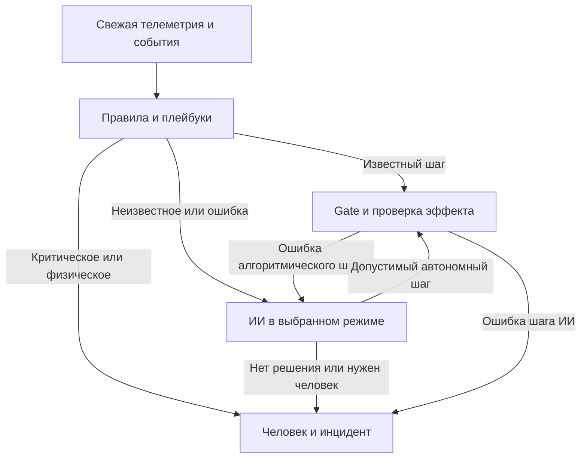

# Все отличия integration/production-safety от main

Дата подготовки: 27.10.2026 (Москва). Репозиторий: **SemOr14/Dome_RAG**.

Отчёт охватывает **всю итоговую сборку**, все задания **0–6** из исходного документа **Dome_RAG_FINAL_v4_26-10-2026.md, версия 4 от 26.10.2026**, интеграционные изменения, исправления после обсуждения и унаследованные отличия выбранной базы от main. Последние два исправления — только часть этого отчёта.

## 1. Точные версии и объём сравнения

| Что | Ветка / commit |
|---|---|
| Главная ветка на момент сверки | main — [1136b28432de4fa1be3f633f89299e645f3e4382](https://github.com/SemOr14/Dome_RAG/commit/1136b28432de4fa1be3f633f89299e645f3e4382) |
| Последний коммит кода перед этим отчётом | integration/production-safety — [f24c87de813e349069941b04fcdee916b0ca5fb4](https://github.com/SemOr14/Dome_RAG/commit/f24c87de813e349069941b04fcdee916b0ca5fb4) |
| Выбранная рабочая база заданий 0–6 | work/resilience-prompts-20261026 — [7292ae75eecac56cb9f4bca12f335504559a2af3](https://github.com/SemOr14/Dome_RAG/commit/7292ae75eecac56cb9f4bca12f335504559a2af3) |
| Первичная совместная сборка заданий | a5da780881fdaaf260e0525d07e77eba5ce8183f |
| Уточнение прежнего отчёта и сравнение с другой веткой | b28c6ee1ad0cfeb4ed75cf7e87517edad2fdca27 |
| Источники организаторов, прочитанные при реализации | WhiteDots/Dome_RAG — 5e1ec4854ddcccb12efc5f0b4a9bfd94fa190438; API blob c7ce91dc2d4f7dfb400ee00465eef4be5ea5ab74 |

[Точное сравнение main → последний код](https://github.com/SemOr14/Dome_RAG/compare/1136b28432de4fa1be3f633f89299e645f3e4382...f24c87de813e349069941b04fcdee916b0ca5fb4).

Сверены полные рекурсивные Git-деревья и SHA файлов, а не только названия коммитов. Main — предок этой сборки: **25 коммитов впереди, 0 позади** до добавления текущего отчёта.

| Срез | Всего отличающихся файлов | Добавлено | Изменено | Удалено |
|---|---:|---:|---:|---:|
| main → f24c87d | **215** | **185** | **30** | **0** |
| Выбранная база 7292ae7 → f24c87d | **46** | **23** | **23** | **0** |
| После добавления этого отчёта и уточнения ссылок/архитектуры README | **216** | **186** | **30** | **0** |

Из 215 отличий кода/материалов **169 уже находились в выбранной базе без последующего изменения**, а **46 изменены после неё**. Это граница происхождения, а не заявление об авторстве всей разницы. RAG и сервис data_api отличаются от main, но их содержимое в заданиях 0–6 не переписывалось. Сам отчёт — ещё один добавленный файл. Финальный документационный коммит также уточняет уже отличающийся README; runtime не меняет.

## 2. Что было в main и что появилось в общей сборке

Main содержал исходную агентную систему, симулятор/старую панель, материалы организаторов, исторические журналы и общие контракты. Итоговая ветка также включает результаты прежних отдельных работ, которые ещё не вошли в main.

| Область | Отличие итоговой ветки от main | Происхождение |
|---|---|---|
| Локальный RAG | Отдельный корпус/индексы, BM25 + ONNX-поиск, FAQ/ситуации/конфликты, CLI/HTTP и опциональный DeepSeek | Унаследовано из базы |
| LLM-слой | Контекст/каталог/граф/RAG → Jinja2-промпт → DeepSeek → структурированный JSON → машинная проверка | База; в чате расширены handoff, диспетчер, схема и системный промпт |
| БД/API | Реализованный SQLite-сервис событий, типы/неизвестные поля, auth, аудит, runs/sessions, controls и импорт | Унаследовано из базы; новая логика интегрирована через существующий контракт |
| Веб-панель | Общий HTTP/UI с обзором, графиками, чатом Оператора, агентом, БД и одним Runner | Унаследовано; в чате добавлены производство, режимы, инциденты и safety |
| Надёжность агента | Пригодность источников, verified-планы, долговечная запись, бюджеты и восстановление pending без слепой отправки | Унаследовано и усилено новым допуском режимов |
| Производство/безопасность | Две карточки, единый Gate, supervisor принтера, жёлтый план и полный красный выход | Задания исходного документа в этом чате |
| Последующая корректировка | Явные исходы ошибок в ИИ/человеку, исключение двойной обработки чата, удаление старой очереди файлов | Исправления после первого отчёта |

## 3. Все задания из исходного документа

### 0. Общие контракты

Добавлены ControlPolicy, DeploymentProfile, AgentMode, независимый algorithms_enabled, OperatingState, policy_epoch, EquipmentCapabilities, ProductionJob и Incident/HumanEscalation.

Режимы: off / recommendation / autonomous. Профиль сервера: competition / service. Объём API: history / full. Неизвестные capabilities недоступны. Таймаут отправленной команды обозначается ambiguous, а accepted/sent не означают verified.

Автор действия сохраняется отдельно как operator / algorithm / agent / safety в совместимом metadata.actor; исходный event envelope и сервис БД не заменены. Зафиксированы operation_id, run_id/session_id, причинные ссылки и отдельная проверка результата.

Файлы: agent/src/kupol/dome/control.py, contracts/production-control-v1.md и дополнение contracts/manual-control.md.

### 1. Режимы ИИ и алгоритмов

В общей области панели появились рекомендательный, автономный режимы и раскрываемое меню «Выключить» с двумя вариантами: только ИИ либо ИИ вместе с алгоритмами. Меню поддерживает hover/focus/click, Escape и структуру для касания/клавиатуры; DOM-поведение проверено, реальный мобильный layout пока нет.

В рекомендательном режиме ИИ предлагает действия, его воздействия автоматически не исполняются; разрешённые алгоритмы работают. Автономный допускает действия модели через общий Gate. Выключение только ИИ оставляет алгоритмы; выключение обоих останавливает обычные управляющие правила и автопродолжение, сохраняя наблюдение/тревоги/журнал.

Серверная политика общая для вкладок. Смена режима/сессии обесценивает старые решения через policy_epoch. Проверка повторяется после ожидания ограничителя непосредственно перед сокетом. confirmed=true больше не обходит профиль, свежесть, состояние и ограничения. Ручной путь, включая старые намерения из БД, доступен только в service вне смены.

### 2. Уведомления и человек

Появился сохраняемый IncidentCenter и постоянный центр тревог панели. Состояния: open → acknowledged → resolved. Дедупликация ведётся по эпизоду; повышение yellow → red доставляется отдельно. Квитирование означает «увидел», не устранение причины и не разрешение resume/reset.

Критические/физические риски классифицируются кодом без ожидания модели. Учитываются функция узла, активное задание и длительность недоступности. Сохранённые старые события после перезапуска помечаются историческими до новых данных.

Каналы — панель и meeting_01 через существующий Gate. Доставка имеет отдельный статус: dry-run, history-only и ошибка не считаются успешным сообщением. Рекурсивный вызов модели при ошибке сообщения в чат исключён.

### 3. Маршрут алгоритм → ИИ → человек

Runner больше не выбирает взаимоисключающе «LLM или плейбуки». Сначала выполняются разрешённые детерминированные правила, затем ИИ получает непокрытый/нестандартный случай и сводку разбора. Известный разрешённый шаг проходит Gate и подтверждение эффекта новым кадром.

Исключение плейбука, локальный отказ Gate, отказ Купола, таймаут и no_effect создают явный повод для анализа. Покрытие узла covered_nodes не подавляет такие командные поводы. Если ИИ выключен/недоступен, ответ невалиден, допустимого решения нет либо действие ИИ само не помогло, создаётся инцидент человеку. В рекомендательном режиме предложение после ошибки также требует человека.

Прямой физический/критический случай идёт человеку сразу. ИИ может вернуть совместимый request_human: устройство, инцидент, severity, факты, уже сделанное и требуемое действие. Gate остаётся общим допуском для алгоритма, ИИ и ручной команды.



Каждый обработанный правилами id сообщения исключается из ИИ отдельно, без пропуска более раннего непонятного вопроса. Повтор одной нерешённой причины не запускает модель каждый тик. В Runner модельные таймеры проверки результата отключены: эффект проверяет Gate; standalone-диспетчер сохраняет свою совместимость.

Ограничение: covered_nodes для остальных телеметрических поводов остаётся эвристикой уровня узла. Полный сохраняемый автомат арбитража каждого incident/job/rule/episode не заявляется. Старые текстовые say/operator_message не все превращены в один структурированный инцидент.

### 4. Отдельный раздел «Производство»

Добавлен раздел общей панели, а не второй сайт. Две карточки: printer_3d_01 и cnc_01. Показаны подключение/свежесть, состояние, текущий файл, удержание/ошибка, последнее воздействие, прогресс, elapsed и ETA. У ЧПУ машинные и рабочие координаты подписаны отдельно.

Файлы берутся штатным list_files. Пользователь выбирает один серверный файл и отдельно выполняет start_job. Resume проходит тот же Gate и проверяет сохранённое задание/координаты/интерлоки/фактический прогресс. UUID операции защищает от повторного HTTP/клика; неизвестный исход сверяется без автоматического повтора. Exactly-once стороннего оборудования не обещается.

Upload реализован только для принтера: готовый UTF-8 G-code до 16 МБ, безопасное имя, разрешённый SHA-256 организаторского файла и запрет перезаписи выполняемого. Без серверного хеша побайтовая удалённая идентичность не объявляется подтверждённой.

ETA прежде всего из телеметрии с источником/временем; запасная оценка — по нескольким устойчивым точкам прогресса. При нехватке данных показано «нет данных». Webhook COMPLETED не доказывает завершение.

Пауза/отмена станков и загрузка ЧПУ отсутствуют в точном API: действия недоступны, питание не используется как скрытая подмена pause. Нет CAM/слайсинга, произвольного G-code, потоковой отправки/дробления УП, последовательного запуска файлов или восстановления ЧПУ по координатам.

### 5. Надзор принтера

Добавлен отдельный серверный PrinterSupervisor: период 10–15 с, по умолчанию 12 с, без открытого UI и нового управляющего WebSocket.

Сверяются свежие данные того же задания, состояние/real_state, пауза/hold, прогресс, elapsed/температуры, ошибка/ALARM, lockout, питание и координаты. Нагрев или один неизменившийся процент не объявляются stall. Порог stall по умолчанию не установлен; задаётся checks.printer.stall_timeout_s.

Одна попытка resume допустима только для известных программных IL_CO2/IL_CONDENSATE после нового подтверждения устранения причины, при сохранённом файле/питании/координатах. Успех требует фактического продолжения того же файла с ростом прогресса. Автоматическим resume принтера владеет supervisor; старый ResumePlaybook для него отфильтрован.

Ручная/неизвестная пауза, FILAMENT_RUNOUT, BED_COLLISION, дым, потеря питания/координат, IDLE/ABORTED требуют человека. Файл не запускается заново автоматически. Явная новая команда — отдельное намерение через обычный Gate. Job_id восстанавливается из существующего журнала в пределах идентичности установки.

### 6. Жёлтая кнопка и красный выход

**Жёлтая** сразу выключает ИИ и обычные алгоритмы, увеличивает epoch, отменяет их планы/авторезюмирование и вызывает Оператора. Наблюдение, журнал и ручной сервисный путь остаются доступны.

В service/full выполняется один ограниченный план отключения второстепенных линий 1,2,3,4,5,6,8, включая ЧПУ на линии 4. Сохраняются линия 7, критические узлы и нужное переходное охлаждение/вытяжка. Смешанная линия 1 не отключается, пока нужна вытяжка; пайку просят выключить физически. При неизвестной продувке/остаточных условиях сохраняется зависимая нагрузка, результат partial. Каждая операция различает requested/accepted/verified/ambiguous/failed.

Нет жёлтого latch/reset. Возврат — обычные режимы и ручные line_on в service с прежними проверками конкретной команды. Смена режима/ручное включение отменяет конфликтующий ещё не отправленный хвост плана. Ничего не включается обратно автоматически.

**Красная** ставит немедленный барьер новых команд/задач, обесценивает результаты и завершает всё наше приложение: HTTP/UI, Runner, WS/переподключение, ИИ, правила, сборщики, потоки и дочерние процессы. Допускается короткий bounded flush, без ожидания модели/оборудования. Launcher принудительно завершает зависшее дерево; не трогает сервер Купола или чужие процессы.

Намеренный красный выход не вызывает restart launcher; пример systemd приложен. Не должно быть внешнего Restart=always. Следующий запуск python run_panel.py — обычный первоначальный старт без red_latch/reset/проверки общей «нормализации». Красная сама не обесточивает оборудование.

### Интеграция и исправления после первого отчёта

Собраны backend и UI всех функций в integration/production-safety: один Hub, один Runner и один транспорт команд. Новые REST наследуют auth, Origin-проверки и HTTP-аудит. Существующие графики/чат/БД сохранены.

После сравнительного чтения кода исправлены:
- Неполная передача исходов Gate/ошибок плейбуков в ИИ и далее человеку.
- Двойная обработка известных сообщений правилами и моделью.
- Двойное владение таймерами проверки эффекта в связке Runner/Dispatcher.
- Старая очередь jobs в TasksPlaybook: queued/waiting_confirm удаляются; starting/started мигрируют только в наблюдение.
- Автоматический старт после освобождения станка/стола или home: теперь нужен новый явный запрос с одним именем файла.
- Повторное исполнение исторического чата при запуске; несколько файлов и второй start одного станка в одном кадре.

Первый отчёт был уточнён: ранние формулировки «очередей нет» и «маршрут полностью завершён» были слишком широкими до последующего исправления. Сравнение с agent/llm-layer сохранено как отдельный отчёт фиксированных снимков, оно не заменяет это сравнение с main.

## 4. Какие детерминированные алгоритмы работают

Это Python-правила с порогами, проверкой пригодности/независимости данных, памятью эпизода, таймерами, разрешённым шагом и Expect. Большинство основных плейбуков существовали в main; часть усилена ранее в базе. Их перечень не означает, что все они написаны заново в этом чате.

| Алгоритм | Суть |
|---|---|
| SmokePlaybook | Сопоставление дыма с независимыми свидетельствами; защита сохраняется без проверяемого допуска события/зоны |
| Co2Playbook | Сверка трёх пригодных CO₂-источников, выбросов/скорости, маркировка и выбор основного, вентиляция и допустимое снятие причины |
| CondensatePlaybook | Влажность/точка росы по независимым источникам; подозрительный датчик отдельно от действующей причины |
| ResumePlaybook | Причина удержания, ALARM, интерлоки, выдержка и бюджет; принтер передан supervisor |
| TasksPlaybook | Простой статус/бокс/одно именованное задание; немедленный старт или отказ без очереди, наблюдение начатого |
| PrinterPlaybook | Реальное состояние/прогресс, ложный webhook, замок, остывание стола и снятие детали |
| EnergyPlaybook | SOC/сеть/генерация/MPPT; E09 требует проверки изоляции, а не погодного reset |
| OvercurrentPlaybook | Повторные срабатывания линий; Gate не разрешает возврат IL_OVERCURRENT только по таймеру |
| PhantomLinePlaybook | Длительная нагрузка резервной линии и допустимое отключение/осмотр |
| AlarmPlaybook | Ограниченные штатные reset/turn_on, затем физическая проверка |
| StalePlaybook | Замершие/недоступные узлы и допустимый reconnect |
| ClockPlaybook | Рассинхрон времени и штатный sync_time |
| NetworkPlaybook | Состояние канала/потери/обрывы; физическое переключение выполняет человек |
| PrinterSupervisor, новый | 12-секундный надзор и одна проверяемая попытка программного восстановления |

Дополнительно работают classify_live, IncidentCenter, Gate/Expect, общий ограничитель, ProductionTracker/ETA, разовый жёлтый план и launcher. Численные пороги находятся в dome.yaml/конфигурации; непроверенные физические нормы не выводятся из UI или модели.

## 5. Унаследованные отличия от main, которые тоже включены в этот отчёт

### RAG — 67 файлов, не переписывался в заданиях 0–6

Добавлены локальный корпус и готовые индексы, 32 FAQ, 24 карточки ситуаций, 12 конфликтов. Retrieval объединяет BM25/точные термины с локальными ONNX-эмбеддингами; есть отдельные справочные фрагменты. CLI/HTTP собирает контекст с происхождением и пятью этапами ответа; опциональный DeepSeek не исполняет команд.

В Git уже находились снимки исходных документов, копии исторических JSONL за 14 октября, происхождение/хеши, evaluation и бинарный dense.npy. В текущем чате эти снимки не импортировались в рабочую БД и не превращались в live. Сохранённые evaluation/live_deepseek_smoke и VALIDATION относятся к прежней работе, не к новым вызовам модели в этой сессии.

### LLM, примеры и диспетчер

Добавлен модуль llm_agent/: клиент DeepSeek, схемы, сбор контекста/каталога/графа, retrieval, промпты, файловое и data_api-хранилища, машинная проверка. Примеры data/ и run_example.py — тестовые входы, не реальные команды.

Диспетчер объединяет события телеметрии, конфликты, stale, ответы команд, сообщения Оператора и обзор. Ограничивает частоту/повторы. Новые Gate-триггеры в чате подключены к этому существующему механизму.

### БД/API — 15 отличающихся файлов, содержимое сохранено относительно базы

Реализованы SQLite-схема/Store, HTTP, redaction, исходные JSON-типы и неизвестные поля, транзакционные события/проекции, run_id/session_id и различие источников. Есть control_intent/validate и отдельные upstream outcome/effect_verified. Сервис не является самостоятельным исполнителем LLM/оборудования. Импорт JSONL — отдельная явная операция; обычный старт не импортирует архив.

Сохраняются auth/Origin и HTTP-аудит. Агентский JSONL не заменён БД: есть start/connection/observation/decision/action/verification/message/llm_call/error и ссылки seq/ref. Обмен с Куполом и моделью попадает в существующий recorder.

### Надёжность и исследования прежней базы

Сохранены исходные типы/null, отбрасываются NaN/Inf/bool как числа; пригодность учитывает online/status/updated_at/reading_delay_s и независимость узлов. Старый/задержанный резерв не опровергает нынешнюю тревогу. Нельзя исключить последний пригодный источник.

Планы ждут нового кадра/времени целевого узла после каждого шага; отказ/неподтверждённый эффект/смена сессии прерывают хвост. Сохраняются pending, бюджеты, антидребезг и durable outbox с fsync. Неизвестная доставка после рестарта сверяется без повторной отправки. Сбой обязательного локального сохранения блокирует новые действия.

Убраны небезопасные reset E09 по погоде, возврат IL_OVERCURRENT по одному таймеру и автоматическая отмена пожарной реакции без допуска текущего события. Исследовательский каталог содержит прежний разбор дня, 32 целевых правила, матрицы/сценарии и XML результатов. Это материалы выбранной базы, не новый полный прогон.

По сравнению с main основной агент/советник уже настроен в базе на deepseek-v4-flash вместо deepseek-chat. В этом чате модель специально не подменялась; переменные окружения имеют приоритет. Настройки автономного RAG отдельные. Наличие выбранной модели в текущем разрешённом списке организаторов ещё требует эксплуатационной сверки.

## 6. Ветки и коммиты работы по исходному документу

Все функциональные ветки созданы от выбранной базы с общим контрактом, а не цепочкой включения чужих функций. Запускать нужно итоговую интеграционную ветку; отдельные feature-ветки — части сборки.

| Задание | Ветка | Реализационный commit |
|---|---|---|
| 0, контракт | work/control-contracts | 0943312f3f59fdcf9eec67edb0d54e171ecbec29 |
| 1, режимы | feat/agent-modes | a2988b300d34339040a46a9596e8e504e2d9ce8d |
| 2, уведомления | feat/incident-alerts | e04744d00ff0e954923df875da07191c7e371be0 |
| 3, маршрут | feat/playbook-routing | 2c099a78e1688f13825fc0baf3ef9ed255a8a6d4 |
| 4, производство | feat/production-console | 632bf75f84c3e5c01ee2a920cc19dbdab32fbce5 |
| 5, надзор | feat/printer-supervisor | 7fd3ff40deb59a517110af370a5ae456a8433825 |
| 6, жёлтая/красная | feat/safe-mode-killswitch | 3f6392e208bc76823de7955e85fb2555e411f58e |
| Совместная сборка | integration/production-safety | a5da780881fdaaf260e0525d07e77eba5ce8183f |
| Исправление описания маршрута/сравнение с веткой агента | integration/production-safety | b28c6ee1ad0cfeb4ed75cf7e87517edad2fdca27 |
| Явный handoff и удаление очереди | integration/production-safety | f24c87de813e349069941b04fcdee916b0ca5fb4 |

Main не менялся; PR/merge в него не выполнялись. Более поздняя agent/llm-layer не сливалась целиком. Её Gate-триггеры перенесены по смыслу и состыкованы с режимами; правка подписи чата по AGENT_NAME и research/real-dome-2026-10-26/README.md этой сборкой не поглощены. RAG и соседние ветки автоматически не обновлялись.

## 7. Запуск и важные настройки

```bash
python -m pip install -r integration/requirements.txt
python run_panel.py
```

Панель: http://127.0.0.1:8080/ui/. Старт не подключает живой Купол и не запускает производство.

| Настройка | Поведение |
|---|---|
| DOME_API_SCOPE | По умолчанию history; full нужен для разрешённого живого API |
| DEPLOYMENT_PROFILE | По умолчанию competition; прямое ручное управление только service вне смены |
| AGENT_MODE / ALGORITHMS_ENABLED | По умолчанию recommendation / 1; серверное состояние для вкладок |
| DOME_ALLOW_CONTROL / AGENT_DRY_RUN | Реальная отправка требует allow=1; dry-run имеет приоритет |
| DOME_URL / DOME_KEY | Только фактическое разрешённое подключение; ключ не в Git |
| DATA_API_DB / DATA_API_TOKEN | Существующая SQLite и авторизация HTTP |
| DATA_API_RUN_ID / PANEL_STATE_DIR | Изоляция запуска и состояния; прежние данные не объявляются live |
| PRODUCTION_APPROVED_SHA256 | Пусто — upload принтера запрещён |
| PRINTER_SUPERVISION_S | 10–15 с, по умолчанию 12 |
| CRITICAL_LINE_MAP | Подтверждённые дополнительные зависимости питания |
| YELLOW_NOZZLE_SAFE_C / YELLOW_PLAN_TIMEOUT_S | Переходное охлаждение / ограничение однократного плана |
| DEEPSEEK_API_KEY, DEEPSEEK_MODEL / LLM_MODEL | Только согласованный DeepSeek; явные настройки имеют приоритет |

Неясность исходной формулировки «только API логов» уточнялась один раз, ответа не было. Поэтому history остаётся исходным ограничением: он даёт историю/анализ, но не start/resume/upload/line_on и не живое сообщение в meeting_01. История не доказывает текущую безопасность.

## 8. Что проверено и что остаётся открытым

После f24c87d прошли **61 адресный Python-тест + 14 тестов TasksPlaybook = 75**, отдельный DOM smoke, compileall и git diff --check. Это offline/временные данные/локальный эмулятор, без реального оборудования, реального meeting_01 и платной модели.

```bash
python -m pytest -q tests/test_routing_fixes.py tests/test_production_control.py tests/test_shutdown_process.py tests/test_resilience_web.py tests/test_dispatcher.py
PYTHONPATH=agent/src:agent python -m pytest -q agent/tests/test_dome_tasks.py
NODE_PATH=/path/to/jsdom/node_modules node tests/web_ui_smoke.cjs
```

Проверены режимы/два клиента, поздний ответ модели, Gate перед сокетом, stale/confirmed/дым, service/competition/auth, start/resume/upload/ETA, UUID-повторы, dedup/yellow→red/ack, сохранённый job_id, частичный жёлтый план и красный процессный выход с повторным обычным запуском.

Новые регрессии проверяют отказ/таймаут/no_effect/позднее подтверждение, исключение плейбука, недоступный/выключенный ИИ, невалидный анализ, ошибку действия ИИ и рекомендательный handoff человеку, epoch, отсутствие рекурсии чата/двойных таймеров и очереди/replay.

**Полный старый suite не зелёный.** Расширенный прогон agent/tests/test_dome_llm_brain.py и test_dome_resilience.py: 45 прошли, 8 не прошли. В отдельной копии родительской версии до текущих исправлений воспроизведены те же восемь:
- test_llm_decides_and_gate_executes_with_verification;
- test_operator_question_is_answered_by_llm;
- test_playbooks_take_over_when_llm_fails;
- test_panel_operator_request_gets_recommendation_even_if_gate_rejects;
- test_rejected_step_prevents_dependent_send;
- test_ack_without_effect_defers_dependent_step;
- test_plan_does_not_continue_after_missing_effect_or_session_change[no_effect];
- test_plan_does_not_continue_after_missing_effect_or_session_change[session_change].

Старые harness используют стартовую history/recommendation и ожидания прежнего маршрута. Их согласование не выполнено этой парой исправлений. Ранее сохранённые отчёты 31/197/773 и другие числа не выдаются за новый полный прогон нынешней ветки.

Открытые границы:
- Реальное оборудование и настоящий ответ модели не испытывались; это частичная аппаратная интеграция.
- Процессный красный тест выполнен на Linux. Windows-ветка psutil реализована, но на Windows не проверена.
- Cloud Browser блокирует localhost, CDN Chromium возвращал Site Unavailable. DOM проверен; размеры/переносы/hover/touch на настоящем мобильном браузере ещё нет.
- API не даёт полного refresh телеметрии, pause/stop станков и upload ЧПУ. Они не придуманы и не заменены обходным доступом.
- Неизвестная продувка/смешанное питание дают partial жёлтого плана, а не ложное «всё выключено».
- Нет полного точного автомата арбитража всех телеметрических incident/job/rule/episode; остаётся covered_nodes и не все старые текстовые сообщения унифицированы в HumanEscalation.
- Для upload без серверного хеша нет доказательства побайтовой удалённой идентичности.
- Список допустимых моделей и фактическая схема дополнительных критических нагрузок требуют сверки перед эксплуатацией.

## 9. Полный реестр файлов

A — добавлен относительно main; M — изменён. Удалённых/переименованных путей нет. Сопоставление идёт по конечным деревьям; внутренние перемещения строк не называются новыми функциями.

Происхождение: **База** — SHA совпадает с выбранной базой; **База + чат** — файл уже отличался от main и доработан после базы; **Чат: новый** — добавлен после базы; **Чат: изменён** — изменён после базы, а до неё совпадал с main. Статус A/M всегда считается относительно main, а не относительно выбранной базы.

### .env.example — 1 файл

| Статус | Путь | Происхождение | Описание отличия |
|---|---|---|---|
| A | `.env.example` | База + чат | Шаблон настроек LLM/БД/панели; добавлены профиль, API scope, режимы, upload и параметры safety. |

### .gitignore — 1 файл

| Статус | Путь | Происхождение | Описание отличия |
|---|---|---|---|
| M | `.gitignore` | База | Перенос записи Keys/ в отдельный блок; ключи остаются исключёнными из Git. |

### README.md — 1 файл

| Статус | Путь | Происхождение | Описание отличия |
|---|---|---|---|
| M | `README.md` | База + чат | Обзор объединённой архитектуры, запуск, RAG/LLM/БД, производство, отчёты и уточнение текущего маршрута. |

### agent — 39 файлов

| Статус | Путь | Происхождение | Описание отличия |
|---|---|---|---|
| M | `agent/.env.example` | База | AGENT_BRAIN, параметры БД/run_id/state; пример модели изменён на deepseek-v4-flash. |
| M | `agent/dome.yaml` | База | Типы/диапазоны вложенных значений замков и вентиляторов; модель советника deepseek-v4-flash. |
| M | `agent/requirements.txt` | База | Зависимости адаптера основного LLM-агента. |
| M | `agent/src/kupol/dome/agentlog.py` | База | Копирование очищенных записей JSONL в подключённый sink БД/контекста. |
| M | `agent/src/kupol/dome/app.py` | База | Выбор llm/rules и создание LlmBrain; встраивание в существующий Runner. |
| A | `agent/src/kupol/dome/brain.py` | База + чат | Адаптер LLM → Intent, журнал контекста, исходы Gate и ошибок правил, передача человеку. |
| M | `agent/src/kupol/dome/checks.py` | База | Пригодность текущих измерений; независимость по узлам, unknown при недостатке свидетельств. |
| M | `agent/src/kupol/dome/client.py` | База + чат | Рекордер полного обмена, единый транспорт/лимитер, ревизия политики и проверка перед сокетом. |
| M | `agent/src/kupol/dome/config.py` | База + чат | Модель советника и необязательный настраиваемый stall_timeout_s принтера. |
| A | `agent/src/kupol/dome/control.py` | Чат: новый | Общие модели ControlPolicy, capabilities, задания, инцидента и критических систем. |
| A | `agent/src/kupol/dome/datalog.py` | База | Долговечная доставка событий обмена в data_api; повтор с прежними ID и fsync. |
| M | `agent/src/kupol/dome/env.py` | База | Настройки AGENT_BRAIN, БД/run_id/state и модели DeepSeek. |
| A | `agent/src/kupol/dome/evidence.py` | База | Пригодность источника: качество, online, updated_at, reading_delay_s и конечные числа. |
| A | `agent/src/kupol/dome/expects.py` | База | Общие ожидания результата команды по новому состоянию. |
| M | `agent/src/kupol/dome/gate.py` | База + чат | Строгий допуск, confirmed без обхода, блокировки узлов, pending/ambiguous, сохранение бюджетов и проверка эффекта. |
| A | `agent/src/kupol/dome/incidents.py` | Чат: новый | Сохраняемые инциденты, dedup, повышение severity, ack, доставка и классификация живых тревог. |
| M | `agent/src/kupol/dome/llm.py` | База | Политика доказательств для диагностического советника и ответов; история/ACK не доказывают безопасность. |
| A | `agent/src/kupol/dome/manual.py` | База | Принятые ручные намерения из БД → Runner/Gate; отчёт о диспетчеризации. |
| M | `agent/src/kupol/dome/playbooks/air.py` | База | CO₂/конденсат: unknown, пригодные независимые датчики, новое подтверждение перед reset. |
| M | `agent/src/kupol/dome/playbooks/base.py` | База + чат | Intent/HumanEscalation, ожидания шагов и набор id сообщений, уже обработанных правилами. |
| M | `agent/src/kupol/dome/playbooks/energy.py` | База | Убран автоматический reset E09 по погоде/таймеру; требуется проверка изоляции человеком. |
| M | `agent/src/kupol/dome/playbooks/machines.py` | База | Для снятия программной причины нужны пригодные текущие данные, а не один датчик. |
| M | `agent/src/kupol/dome/playbooks/tasks.py` | Чат: изменён | Один немедленный именованный start; удалена очередь и автоматический home→start; наблюдение начатого. |
| A | `agent/src/kupol/dome/printer_supervisor.py` | Чат: новый | Серверный надзор 12 с; одна попытка resume того же задания после допустимой программной причины. |
| A | `agent/src/kupol/dome/routing.py` | Чат: новый | Алгоритмы раньше LLM; приоритет, сводка, покрытие, ошибки и обработанные сообщения. |
| M | `agent/src/kupol/dome/runner.py` | База + чат | Общий исполнитель режимов/правил/LLM/человека; проверяемые планы, инциденты, supervisor, ручной путь и запрет replay истории. |
| M | `agent/src/kupol/dome/state.py` | База | Отсев NaN/Inf/bool из чисел; обнаружение offline и замершего времени узлов. |
| M | `agent/tests/dome_fake/server.py` | База | Эмулятор WebSocket: обмен, чат и тестовые ответы управления. |
| M | `agent/tests/dome_fake/world.py` | База | Тестовый мир: телеметрия, задания, удержания и эффекты команд. |
| M | `agent/tests/dome_helpers.py` | База | Общие фикстуры актуальности/состояния для тестов агента. |
| M | `agent/tests/test_dome_checks.py` | База | Проверки качества и независимости измерений. |
| M | `agent/tests/test_dome_gate.py` | База | Проверки новых ограничений Gate и допустимости команд. |
| A | `agent/tests/test_dome_llm_brain.py` | База | Сценарии полного LLM-контура с подменённой моделью; четыре старых сценария сейчас не проходят. |
| A | `agent/tests/test_dome_manual_control.py` | База | Сценарии ручных намерений и их прохождения через Gate. |
| M | `agent/tests/test_dome_playbooks_air.py` | База | Проверки исправленных правил CO₂/конденсата. |
| M | `agent/tests/test_dome_playbooks_ops.py` | База | Проверки эксплуатационных правил, включая запрет reset E09 по эвристике погоды. |
| A | `agent/tests/test_dome_resilience.py` | База | Регрессии качества данных, сохранения/эффекта/планов; четыре старых сценария сейчас не проходят. |
| M | `agent/tests/test_dome_scenarios.py` | База | Эмуляторный harness и сценарии поведения агента. |
| M | `agent/tests/test_dome_tasks.py` | Чат: изменён | Обновлённые проверки одиночного старта без очереди; статус, бокс и наблюдение завершения. |

### contracts — 2 файлов

| Статус | Путь | Происхождение | Описание отличия |
|---|---|---|---|
| A | `contracts/manual-control.md` | База + чат | Контракт ручного намерения через БД/Runner; добавлены service/competition и policy_epoch. |
| A | `contracts/production-control-v1.md` | Чат: новый | Контракты режимов, заданий, capabilities, инцидентов, safety и дополнение о handoff/одиночных файлах. |

### data — 12 файлов

| Статус | Путь | Происхождение | Описание отличия |
|---|---|---|---|
| A | `data/catalog_static.json` | База | Статический каталог для локальных примеров; не заменяет живые capabilities. |
| A | `data/hard_rules.yaml` | База | Жёсткие правила, включаемые в промпт и машинную проверку. |
| A | `data/influence_graph.yaml` | База | Граф связей узлов для отбора релевантного контекста. |
| A | `data/rag/case_bed_and_webhook.md` | База | Запасной RAG-кейс о занятом столе и ложном завершении webhook. |
| A | `data/rag/case_co2_false_primary.md` | База | Запасной RAG-кейс о подозрительном основном CO₂-датчике. |
| A | `data/rag/case_co2_real.md` | База | Запасной RAG-кейс о реальном росте CO₂. |
| A | `data/rag/faq.jsonl` | База | Запасной набор FAQ для keyword/BM25 retrieval. |
| A | `data/samples/decision_journal.jsonl` | База | Тестовый журнал решений для примеров LLM. |
| A | `data/samples/scenarios/bed_occupied.json` | База | Пример сценария занятого стола принтера. |
| A | `data/samples/scenarios/co2_false_alarm.json` | База | Пример сценария подозрительного CO₂-сигнала. |
| A | `data/samples/scenarios/evening_low_soc.json` | База | Пример сценария низкого SOC. |
| A | `data/samples/telemetry_latest.json` | База | Файловая телеметрия-пример; не живой кадр. |

### docs — 3 файлов

| Статус | Путь | Происхождение | Описание отличия |
|---|---|---|---|
| A | `docs/Dome_changes_and_routing_27-10-2026.md` | Чат: новый | Ранее сделанное сравнение с agent/llm-layer; список правил и последующее исправление найденных пробелов. |
| A | `docs/production-safety-report.md` | Чат: новый | Отчёт заданий 0–6, ветки/коммиты, проверки, ограничения и результаты исправлений. |
| A | `docs/production-safety-sources.json` | Чат: новый | Точные SHA выбранной базы, документов организаторов и функциональных веток. |

### integration — 21 файлов

| Статус | Путь | Происхождение | Описание отличия |
|---|---|---|---|
| A | `integration/README.md` | База + чат | Запуск панели, настройки, режимы, маршрут, производство, safety и фактические проверки. |
| A | `integration/__init__.py` | База | Пакет веб-интеграции. |
| A | `integration/demo_dome.py` | База | Локальный эмулятор для тестового подключения панели. |
| A | `integration/dome-panel.service.example` | Чат: новый | Пример systemd без автоматического рестарта после намеренного красного выхода. |
| A | `integration/incident_routes.py` | Чат: новый | REST списка/квитирования инцидентов через существующие auth и аудит. |
| A | `integration/launcher.py` | Чат: новый | Владелец дерева процессов; bounded shutdown, принудительное завершение и обычный повторный запуск. |
| A | `integration/production.py` | Чат: новый | Две производственные карточки/API, одно задание, capabilities, upload и ETA/идемпотентность. |
| A | `integration/requirements.txt` | База + чат | Зависимости общей панели, БД, LLM и управления деревом процессов. |
| A | `integration/runtime.py` | База + чат | Hub/Runner, подключение, серверная политика, БД, capabilities, инциденты и production state. |
| A | `integration/safety.py` | Чат: новый | Разовый жёлтый план по зависимостям и немедленный красный барьер/выход. |
| A | `integration/server.py` | База + чат | HTTP общей панели и существующей БД/API; маршруты режимов, производства, инцидентов, safety. |
| A | `integration/test_smoke.py` | База | Существующий smoke общей HTTP-интеграции. |
| A | `integration/web/agent-modes.js` | Чат: новый | Рекомендательный/автономный режимы и доступное меню двух выключений. |
| A | `integration/web/app.js` | База + чат | Общая панель: обзор/графики/чат/агент/БД, интеграция новых разделов и серверного режима. |
| A | `integration/web/incident-center.js` | Чат: новый | Центр жёлтых/красных тревог и ручное квитирование. |
| A | `integration/web/index.html` | База + чат | Навигация, раздел Производство, режимы, центр тревог и постоянные safety-кнопки. |
| A | `integration/web/production-control.js` | Чат: новый | Оркестрация модулей производства, режимов, уведомлений и safety в панели. |
| A | `integration/web/production.js` | Чат: новый | Карточки принтера/ЧПУ, выбор файла, отдельные start/resume/upload, состояния и ETA. |
| A | `integration/web/safety-controls.js` | Чат: новый | Кнопки жёлтого перехода и красного завершения, отображение результата. |
| A | `integration/web/style.css` | База + чат | Стили общей панели и новых карточек/меню/уведомлений, адаптивные правила. |
| A | `integration/worker.py` | Чат: новый | Процесс веб-приложения под управлением launcher. |

### llm_agent — 21 файлов

| Статус | Путь | Происхождение | Описание отличия |
|---|---|---|---|
| A | `llm_agent/__init__.py` | База | Публичный интерфейс LLM-слоя и Settings. |
| A | `llm_agent/agent.py` | База | Сбор контекста → вызов DeepSeek → разбор/проверка → запись решения. |
| A | `llm_agent/config.py` | База | Настройки модели, контекста, retrieval, БД и диспетчера. |
| A | `llm_agent/context/__init__.py` | База | Пакет формирования контекста. |
| A | `llm_agent/context/catalog.py` | База | Разрешённые узлы/действия и актуальный каталог для промпта/валидации. |
| A | `llm_agent/context/graph.py` | База | Отбор подграфа влияний вокруг значимых узлов. |
| A | `llm_agent/context/telemetry.py` | База | Представление телеметрии и признаков для контекста модели. |
| A | `llm_agent/dispatcher.py` | База + чат | Событийные вызовы, объединение/лимиты/дедупликация, handled ids; в Runner проверкой эффекта владеет Gate. |
| A | `llm_agent/llm_client.py` | База | Клиент DeepSeek с результатом/ошибкой/статистикой вызова. |
| A | `llm_agent/prompt_builder.py` | База | Jinja2-сборка системного и пользовательского промптов. |
| A | `llm_agent/rag/__init__.py` | База | Интерфейс подключения retrieval. |
| A | `llm_agent/rag/base.py` | База | Общий контракт результатов retrieval. |
| A | `llm_agent/rag/dome.py` | База | Адаптер согласованного локального RAG Купола. |
| A | `llm_agent/rag/keyword.py` | База | Запасной локальный keyword/BM25 поиск. |
| A | `llm_agent/schemas.py` | База + чат | Структурированный ответ/действия/вердикты; совместимый request_human. |
| A | `llm_agent/storage/__init__.py` | База | Интерфейсы хранения и чтения контекста. |
| A | `llm_agent/storage/base.py` | База | Базовые контракты хранилищ телеметрии/решений/событий. |
| A | `llm_agent/storage/data_api.py` | База | Адаптер действующей БД/API, записи LLM и серверная проверка controls. |
| A | `llm_agent/storage/file_store.py` | База | Файловые входы/журнал для локального запуска примеров. |
| A | `llm_agent/triggers.py` | База + чат | Детекторы телеметрии/чата/исходов команд; Gate refusal/timeout/no_effect и ошибки плейбуков. |
| A | `llm_agent/validate.py` | База | Машинная проверка JSON/каталога/прав и жёстких правил перед Intent. |

### prompts — 2 файлов

| Статус | Путь | Происхождение | Описание отличия |
|---|---|---|---|
| A | `prompts/system.md.j2` | База + чат | Политика доказательств, ограничений действий и структурированного вызова человека. |
| A | `prompts/user.md.j2` | База | Повод, текущее состояние/каталог, история действий, граф и RAG-контекст. |

### rag — 67 файлов

| Статус | Путь | Происхождение | Описание отличия |
|---|---|---|---|
| A | `rag/.env.example` | База | Шаблон настроек автономного RAG и опционального DeepSeek. |
| A | `rag/.gitattributes` | База | Правила сохранения исходных окончаний строк и файлов снимка. |
| A | `rag/.gitignore` | База | Исключения локального окружения/кэша RAG. |
| A | `rag/AGENT_TRIGGERS.md` | База | Предлагаемые события и контрольные таймеры для агента. |
| A | `rag/README.md` | База | Установка и описание согласованного локального retrieval/HTTP/CLI. |
| A | `rag/VALIDATION.md` | База | Исторические результаты проверки RAG; не новый прогон текущей сборки. |
| A | `rag/data/APPROVAL.json` | База | Основание согласованного импорта/редактирования базы RAG. |
| A | `rag/data/evaluation/acceptance_cases.json` | База | Приёмочные примеры для retrieval. |
| A | `rag/data/knowledge_base/api_constraints.json` | База | Ограничения API в контексте RAG. |
| A | `rag/data/knowledge_base/conflicts.json` | База | Реестр конфликтов документов/рекомендаций. |
| A | `rag/data/knowledge_base/faq_curated.json` | База | 32 согласованных FAQ. |
| A | `rag/data/knowledge_base/faq_source_candidates.json` | База | Исходные кандидаты FAQ, не готовые управляющие инструкции. |
| A | `rag/data/knowledge_base/log_evidence_summary.json` | База | Сводка исторических свидетельств из журналов. |
| A | `rag/data/knowledge_base/situation_source_candidates.json` | База | Кандидаты ситуаций с происхождением. |
| A | `rag/data/knowledge_base/situations.json` | База | 24 согласованные карточки ситуаций. |
| A | `rag/data/sources/01_API.md` | База | Входной снимок документа 01_API.md с происхождением/хешем; добавлен ранее в RAG. |
| A | `rag/data/sources/02_Задание_и_оценка.md` | База | Входной снимок документа 02_Задание_и_оценка.md с происхождением/хешем; добавлен ранее в RAG. |
| A | `rag/data/sources/03_Требования_к_агенту.md` | База | Входной снимок документа 03_Требования_к_агенту.md с происхождением/хешем; добавлен ранее в RAG. |
| A | `rag/data/sources/04_Как_создаётся_агент.md` | База | Входной снимок документа 04_Как_создаётся_агент.md с происхождением/хешем; добавлен ранее в RAG. |
| A | `rag/data/sources/Logs/2026-10-14/events.jsonl` | База | Унаследованная копия исторического events.jsonl для RAG; не live и не импорт в рабочую БД. |
| A | `rag/data/sources/Logs/2026-10-14/logbook.jsonl` | База | Унаследованная копия исторического logbook.jsonl для RAG; не live и не импорт в рабочую БД. |
| A | `rag/data/sources/Logs/2026-10-14/telemetry.jsonl` | База | Унаследованная копия исторического telemetry.jsonl для RAG; не live и не импорт в рабочую БД. |
| A | `rag/data/sources/dome_sandbox_nodes.md` | База | Входной снимок документа dome_sandbox_nodes.md с происхождением/хешем; добавлен ранее в RAG. |
| A | `rag/data/sources/knowledge/00_assistant.md` | База | Неизменённый входной снимок раздела базы знаний: 00_assistant.md. |
| A | `rag/data/sources/knowledge/01_legend.md` | База | Неизменённый входной снимок раздела базы знаний: 01_legend.md. |
| A | `rag/data/sources/knowledge/02_station.md` | База | Неизменённый входной снимок раздела базы знаний: 02_station.md. |
| A | `rag/data/sources/knowledge/03_energy.md` | База | Неизменённый входной снимок раздела базы знаний: 03_energy.md. |
| A | `rag/data/sources/knowledge/04_telemetry.md` | База | Неизменённый входной снимок раздела базы знаний: 04_telemetry.md. |
| A | `rag/data/sources/knowledge/05_production.md` | База | Неизменённый входной снимок раздела базы знаний: 05_production.md. |
| A | `rag/data/sources/knowledge/06_microclimate.md` | База | Неизменённый входной снимок раздела базы знаний: 06_microclimate.md. |
| A | `rag/data/sources/knowledge/07_rules.md` | База | Неизменённый входной снимок раздела базы знаний: 07_rules.md. |
| A | `rag/data/sources/knowledge/08_safety.md` | База | Неизменённый входной снимок раздела базы знаний: 08_safety.md. |
| A | `rag/data/sources/knowledge/09_faults.md` | База | Неизменённый входной снимок раздела базы знаний: 09_faults.md. |
| A | `rag/data/sources/knowledge/10_procedures.md` | База | Неизменённый входной снимок раздела базы знаний: 10_procedures.md. |
| A | `rag/data/sources/knowledge/11_reference.md` | База | Неизменённый входной снимок раздела базы знаний: 11_reference.md. |
| A | `rag/data/sources/knowledge/12_history.md` | База | Неизменённый входной снимок раздела базы знаний: 12_history.md. |
| A | `rag/data/sources/register.json` | База | Реестр и хеши неизменённых входных снимков. |
| A | `rag/data/sources/sections.json` | База | Разметка секций первичных источников. |
| A | `rag/evaluation/build_validation.json` | База | Сохранённый результат проверки сборки индекса. |
| A | `rag/evaluation/hybrid_report.json` | База | Сохранённая оценка гибридного retrieval. |
| A | `rag/evaluation/lexical_report.json` | База | Сохранённая оценка лексического retrieval. |
| A | `rag/evaluation/live_deepseek_smoke.json` | База | Унаследованный результат прежнего DeepSeek smoke; в этом чате платный вызов не выполнялся. |
| A | `rag/evaluation/paraphrases.json` | База | Проверочный набор перефразированных запросов. |
| A | `rag/evaluation/smoke_local.json` | База | Унаследованный результат локального RAG smoke. |
| A | `rag/index/dense.npy` | База | Готовый бинарный индекс эмбеддингов; не новая модель и не обучение в этом чате. |
| A | `rag/index/metadata.json` | База | Версия, параметры и происхождение индекса. |
| A | `rag/index/records.json` | База | Индексируемые согласованные записи. |
| A | `rag/index/references.json` | База | Отдельные справочные фрагменты источников. |
| A | `rag/pyproject.toml` | База | Пакет/CLI автономного RAG. |
| A | `rag/rag/__init__.py` | База | Публичный пакет retrieval. |
| A | `rag/rag/__main__.py` | База | Запуск CLI через python -m rag. |
| A | `rag/rag/app.py` | База | Сборка retrieval и ответа с источниками. |
| A | `rag/rag/cli.py` | База | Команды search/context/ask/build/evaluate/serve. |
| A | `rag/rag/common.py` | База | Общие типы/утилиты корпуса и ссылок. |
| A | `rag/rag/context.py` | База | Бюджет контекста, ссылки, конфликты и этапы ответа. |
| A | `rag/rag/corpus.py` | База | Проверка снимков и построение корпуса/индекса. |
| A | `rag/rag/dense.py` | База | Локальные ONNX-эмбеддинги и векторный поиск. |
| A | `rag/rag/evaluate.py` | База | Оценка retrieval на заданном наборе. |
| A | `rag/rag/llm.py` | База | Опциональный DeepSeek и проверка структуры/ссылок ответа. |
| A | `rag/rag/search.py` | База | BM25/точные термины/векторы и объединение рангов. |
| A | `rag/rag/server.py` | База | Локальный HTTP retrieval API без управления оборудованием. |
| A | `rag/requirements-lock.txt` | База | Зафиксированные зависимости исходной проверенной RAG-сборки. |
| A | `rag/requirements-semantic.txt` | База | Зависимости семантического поиска. |
| A | `rag/setup.ps1` | База | Установка RAG/ONNX и сборка индекса в Windows. |
| A | `rag/tests/test_rag.py` | База | Локальные проверки retrieval, происхождения и ответа. |
| A | `rag/tools/import_approved.py` | База | Явный импорт согласованного корпуса; не вызывается обычным стартом. |
| A | `rag/tools/package.py` | База | Упаковка автономного RAG. |

### requirements.txt — 1 файл

| Статус | Путь | Происхождение | Описание отличия |
|---|---|---|---|
| A | `requirements.txt` | База | Зависимости общего LLM-слоя и запуска примеров. |

### research — 17 файлов

| Статус | Путь | Происхождение | Описание отличия |
|---|---|---|---|
| A | `research/resilience-2026-10-26/README.md` | База | Исторический отчёт доработки resilience поверх 2e0c035; его числа тестов не относятся к новому прогону. |
| A | `research/resilience-2026-10-26/implementation_manifest.json` | База | Состав и версия прежней реализации resilience. |
| A | `research/resilience-2026-10-26/replay_day.py` | База | Диагностический replay исторического дня без новых команд оборудованию. |
| A | `research/resilience-2026-10-26/replay_result.json` | База | Сохранённый результат прежнего исторического replay. |
| A | `research/resilience-2026-10-26/reports/agent_current_tests.xml` | База | Сохранённый XML прежних агентных проверок. |
| A | `research/resilience-2026-10-26/reports/baseline_all_tests.xml` | База | Сохранённый XML прежней исходной серии тестов. |
| A | `research/resilience-2026-10-26/reports/current_dome_tests.xml` | База | Сохранённый XML прежних проверок контура Купола. |
| A | `research/resilience-2026-10-26/reports/integration_tests.xml` | База | Сохранённый XML прежних интеграционных проверок. |
| A | `research/resilience-2026-10-26/test_results.json` | База | Реестр прежних тестов и их границ. |
| A | `research/resilience-2026-10-26/verify.ps1` | База | Скрипт повторения прежних проверок на отдельной среде. |
| A | `research/resilience-2026-10-26/ИНСТРУКЦИИ_АГЕНТУ.md` | База | Инженерная политика и ограничения ранее выбранной базы. |
| A | `research/resilience-2026-10-26/Источники_и_версия.json` | База | Версии источников и основания прежней работы. |
| A | `research/resilience-2026-10-26/Матрица_инструкций.md` | База | Связь прежних требований с кодом и проверками. |
| A | `research/resilience-2026-10-26/Плейбуки_агента.json` | База | 32 целевых правила; не 32 реализованных самостоятельных контроллера. |
| A | `research/resilience-2026-10-26/Приёмочные_сценарии.json` | База | Прежняя спецификация приёмочных сценариев. |
| A | `research/resilience-2026-10-26/РАЗБОР_ДНЯ.md` | База | Исторический анализ 1440 кадров и эпизодов. |
| A | `research/resilience-2026-10-26/Реестр_эпизодов.json` | База | Структурированный реестр исторических эпизодов. |

### run_dispatcher.py — 1 файл

| Статус | Путь | Происхождение | Описание отличия |
|---|---|---|---|
| A | `run_dispatcher.py` | База | CLI событийного диспетчера; dry-run и однократный анализ. |

### run_example.py — 1 файл

| Статус | Путь | Происхождение | Описание отличия |
|---|---|---|---|
| A | `run_example.py` | База | CLI примеров формирования промпта и структурированного решения. |

### run_panel.py — 1 файл

| Статус | Путь | Происхождение | Описание отличия |
|---|---|---|---|
| A | `run_panel.py` | База + чат | Обычный запуск панели через launcher, необходимый для полного завершения по красной. |

### services — 15 файлов

| Статус | Путь | Происхождение | Описание отличия |
|---|---|---|---|
| A | `services/data_api/AGENT_INTERFACE.md` | База | Обмен промптом, структурированным решением, намерением, отправкой и проверкой эффекта. |
| M | `services/data_api/README.md` | База | Описание реализованного SQLite/HTTP сервиса, настройки и работа с данными. |
| A | `services/data_api/data_api/__init__.py` | База | Публичный пакет сервиса БД/API. |
| A | `services/data_api/data_api/app.py` | База | HTTP API событий, телеметрии, runs, controls, auth/Origin и аудит. |
| A | `services/data_api/data_api/codec.py` | База | Кодирование конверта и исходных JSON-типов. |
| A | `services/data_api/data_api/control_rules.py` | База | Проверки каталога, прав, состояния и значений control_intent. |
| A | `services/data_api/data_api/controls.py` | База | Проекция намерений и ответов controls; upstream outcome отдельно от эффекта. |
| A | `services/data_api/data_api/import_jsonl.py` | База | Явный импорт JSONL; сам запуск панели импорт не выполняет. |
| A | `services/data_api/data_api/redaction.py` | База | Скрытие секретных значений при сохранении. |
| A | `services/data_api/data_api/store.py` | База | SQLite-хранилище событий/проекций и транзакций. |
| A | `services/data_api/migrations/001_initial.sql` | База | Начальная схема SQLite. |
| A | `services/data_api/pyproject.toml` | База | Метаданные Python-пакета сервиса. |
| A | `services/data_api/requirements-dev.txt` | База | Зависимости разработки/тестов сервиса. |
| A | `services/data_api/requirements.txt` | База | Рабочие зависимости сервиса. |
| A | `services/data_api/tests/test_service.py` | База | Проверки хранения, API и правил сервиса. |

### tests — 9 файлов

| Статус | Путь | Происхождение | Описание отличия |
|---|---|---|---|
| A | `tests/test_data_api_integration.py` | База | Интеграционные проверки LLM-слоя и сервиса данных. |
| A | `tests/test_dispatcher.py` | База | События, дедупликация, интервалы, ошибки модели и проверки диспетчера. |
| A | `tests/test_dome_wire_to_data_api.py` | База | Сохранение исходного входа/выхода WebSocket в data_api. |
| A | `tests/test_production_control.py` | Чат: новый | Режимы/Gate/производство/ETA/upload/инциденты/жёлтый сценарий и гонки. |
| A | `tests/test_resilience_storage.py` | База | Сохранение, долговечная доставка и восстановление событий. |
| A | `tests/test_resilience_web.py` | База | Существующие проверки HTTP/панели и входных запросов. |
| A | `tests/test_routing_fixes.py` | Чат: новый | Регрессии алгоритм/Gate → ИИ → человек и отсутствия очереди/replay. |
| A | `tests/test_shutdown_process.py` | Чат: новый | Красная: зависший worker/поток, закрытие порта/дерева, живой эмулятор и новый запуск. |
| A | `tests/web_ui_smoke.cjs` | Чат: новый | DOM smoke двух карточек, недоступных действий, меню, режимов и ack. |

### Сам этот отчёт — ещё 1 файл

| Статус | Путь | Происхождение | Описание отличия |
|---|---|---|---|
| A | `docs/Dome_all_changes_vs_main_27-10-2026.md` | Чат: новый | Полное сравнение с main: все задания, унаследованные компоненты, файлы, коммиты, проверки и ограничения. |

## 10. Полная история коммитов, отсутствующих в main

Список получен GitHub compare для закреплённых SHA. Он включает merge-коммиты и не означает, что каждый коммит создан в этом чате. Первые 15 входят в выбранную базу, следующие 10 относятся к заданиям и последующим исправлениям.

| № | Commit | Содержание | Этап |
|---:|---|---|---|
| 1 | [6f6f8d0](https://github.com/SemOr14/Dome_RAG/commit/6f6f8d06f6a77b1f5ad4df3c080caac5630fddc7) | Add grounded local RAG with semantic retrieval and DeepSeek adapter | Выбранная база |
| 2 | [a3cce84](https://github.com/SemOr14/Dome_RAG/commit/a3cce8462f5233172bfd07ec03efc244b988e8ef) | Preserve hashed source line endings and refresh lexical checks | Выбранная база |
| 3 | [dba6153](https://github.com/SemOr14/Dome_RAG/commit/dba6153124979ebeb8efbb7477a3501dabd7b93f) | Add LLM layer of the dome agent (prompt -> DeepSeek -> structured decision) | Выбранная база |
| 4 | [a944040](https://github.com/SemOr14/Dome_RAG/commit/a944040a0d210b2086ae216bdb55a372e7c0219c) | Merge remote-tracking branch 'origin/rag/local-retrieval-20261026' into agent/llm-layer | Выбранная база |
| 5 | [cb8ad3e](https://github.com/SemOr14/Dome_RAG/commit/cb8ad3e111a53b0a6082120445bdacbef0ec3f7d) | Document proposed agent triggers | Выбранная база |
| 6 | [a3dd79d](https://github.com/SemOr14/Dome_RAG/commit/a3dd79da0ef94d9e6875333d6b94e54bc801f260) | Connect the agent to the Dome RAG (FAQ, situations, source conflicts) | Выбранная база |
| 7 | [d7bee62](https://github.com/SemOr14/Dome_RAG/commit/d7bee62a442c84bab233409e8cb287b13b33e1b3) | Implement SQLite event storage, audited HTTP API and control validation | Выбранная база |
| 8 | [ef7489f](https://github.com/SemOr14/Dome_RAG/commit/ef7489ff51debd28cba4c260f5e56a0e65f0dbb1) | Merge data API into the LLM layer and record all dome I/O in the database | Выбранная база |
| 9 | [cdd8a26](https://github.com/SemOr14/Dome_RAG/commit/cdd8a268960c9741882efbbb597337bd79b8260c) | Merge remote-tracking branch 'origin/rag/local-retrieval-20261026' into agent/llm-layer | Выбранная база |
| 10 | [085ee73](https://github.com/SemOr14/Dome_RAG/commit/085ee736c39296b1c21f72883300eeb2bfcf0efb) | Integrate new web panel with current LLM agent, Gate and SQLite API | Выбранная база |
| 11 | [4adeaac](https://github.com/SemOr14/Dome_RAG/commit/4adeaac6c45f26ca80a608c4398ff73a8eb8dea1) | Make the LLM agent the decision core and route manual operator commands through the Gate | Выбранная база |
| 12 | [fb7f4d7](https://github.com/SemOr14/Dome_RAG/commit/fb7f4d7b14f62d35decb9e57f46522f166b75d4e) | Merge remote-tracking branch 'origin/integration/web-agent-data-api' into agent/llm-layer | Выбранная база |
| 13 | [86b272e](https://github.com/SemOr14/Dome_RAG/commit/86b272eb9779f533e87855dea6bb45ca7c24e0e5) | Run the agent from the web panel, add operator chat and a dome emulator test mode | Выбранная база |
| 14 | [2e0c035](https://github.com/SemOr14/Dome_RAG/commit/2e0c0350952ea251a98a35c1597433e1acac2f99) | Fix live dome issues found in operation; operator chat with the LLM agent | Выбранная база |
| 15 | [7292ae7](https://github.com/SemOr14/Dome_RAG/commit/7292ae75eecac56cb9f4bca12f335504559a2af3) | Harden Dome agent prompts, verified recovery and durable event recording | Выбранная база |
| 16 | [0943312](https://github.com/SemOr14/Dome_RAG/commit/0943312f3f59fdcf9eec67edb0d54e171ecbec29) | Define production control contracts, profiles, capabilities and policy epochs | Задания и исправления |
| 17 | [a2988b3](https://github.com/SemOr14/Dome_RAG/commit/a2988b300d34339040a46a9596e8e504e2d9ce8d) | Enforce independent agent modes and policy epoch at Gate and socket send | Задания и исправления |
| 18 | [e04744d](https://github.com/SemOr14/Dome_RAG/commit/e04744d00ff0e954923df875da07191c7e371be0) | Persist deduplicated incidents, human acknowledgement and delivery status | Задания и исправления |
| 19 | [2c099a7](https://github.com/SemOr14/Dome_RAG/commit/2c099a78e1688f13825fc0baf3ef9ed255a8a6d4) | Add algorithm-first routing and structured human escalation | Задания и исправления |
| 20 | [632bf75](https://github.com/SemOr14/Dome_RAG/commit/632bf75f84c3e5c01ee2a920cc19dbdab32fbce5) | Add capability-gated single-job production API and measured ETA tracking | Задания и исправления |
| 21 | [7fd3ff4](https://github.com/SemOr14/Dome_RAG/commit/7fd3ff40deb59a517110af370a5ae456a8433825) | Supervise printer on fresh frames with a single verified software-hold recovery | Задания и исправления |
| 22 | [3f6392e](https://github.com/SemOr14/Dome_RAG/commit/3f6392e208bc76823de7955e85fb2555e411f58e) | Add dependency-aware one-shot yellow plan and bounded process-tree shutdown | Задания и исправления |
| 23 | [a5da780](https://github.com/SemOr14/Dome_RAG/commit/a5da780881fdaaf260e0525d07e77eba5ce8183f) | Integrate production console, verified recovery, incidents, agent modes and full application shutdown | Задания и исправления |
| 24 | [b28c6ee](https://github.com/SemOr14/Dome_RAG/commit/b28c6ee1ad0cfeb4ed75cf7e87517edad2fdca27) | Document exact branch differences, registered algorithms and routing gaps | Задания и исправления |
| 25 | [f24c87d](https://github.com/SemOr14/Dome_RAG/commit/f24c87de813e349069941b04fcdee916b0ca5fb4) | Fix explicit algorithm and Gate failure handoff; remove deferred file jobs | Задания и исправления |

Текущий отчёт публикуется следующим документационным коммитом поверх f24c87d; README получает ссылку и уточнение текущей архитектуры. После публикации будет 26 коммитов впереди закреплённого main. SHA самого документационного коммита виден в истории Git: его нельзя включить в собственное содержимое без изменения этого SHA.
