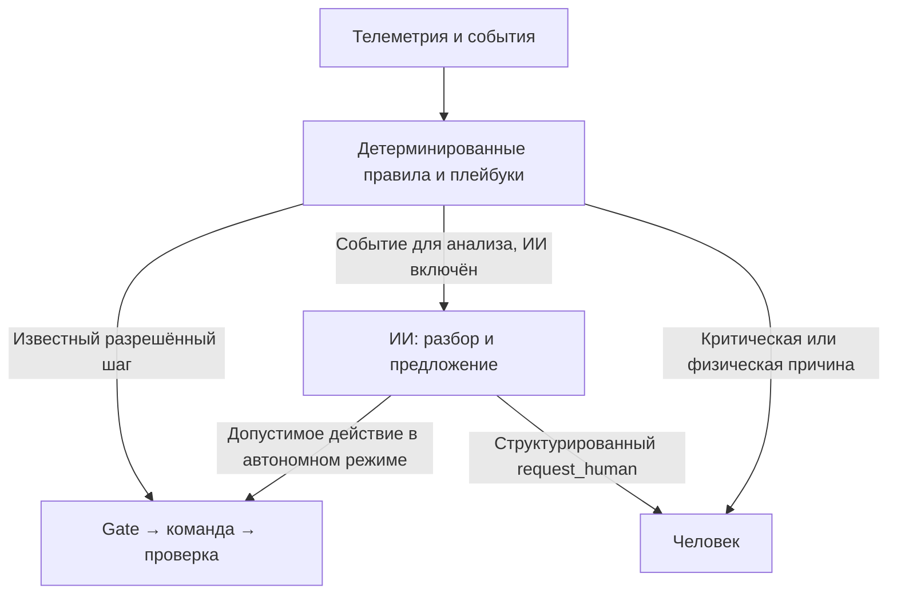

# Отличия сборки и маршрут «алгоритм → ИИ → человек»

Дата: 27.10.2026. Раздел 0 описывает последующие исправления. Разделы 1–8 сохраняют сравнение фиксированных снимков `a5da780` и `c177317`: приведённые там числа и прежние пробелы относятся именно к этим снимкам, а не к текущей голове ветки.

## 0. Исправления после сравнения

Два выявленных пробела устранены в `integration/production-safety`:

1. Исключения плейбуков и refusal/timeout/no_effect Gate создают явный триггер ИИ, независимо от covered_nodes. Gate-триггеры из более новой ветки перенесены по смыслу с сохранением policy_epoch, запрета слепых повторов и единственного владельца проверки эффекта — Gate. При выключенном/недоступном ИИ, невалидном анализе, отсутствии допустимого решения или неудаче действия ИИ создаётся инцидент человеку. Предложение в рекомендательном режиме тоже требует человека. Ошибка доставки в чат не запускает рекурсию; старое поколение политики игнорируется. Позднее подтверждение после таймаута закрывает неопределённость, не требует повторной команды.
2. Очередь jobs и автоматический _advance удалены из TasksPlaybook. Один явный запрос может создать только один немедленный start_job. Занятость, занятый стол и неподтверждённые координаты означают отказ; исправление условий само не запускает файл. Нужен новый запрос с именем файла. Старые queued/waiting_confirm удаляются, starting/started мигрируют только в наблюдение. Исторический чат при старте не исполняется; несколько файлов и второй запуск того же станка в одном кадре отклоняются.

Обработанные правилами сообщения исключаются из ИИ по конкретным id, без потери более раннего непонятного сообщения. Это уточняет арбитраж сообщений и исходов команд; covered_nodes для остальных телеметрических поводов по-прежнему остаётся эвристикой уровня узла.

Проверка: **61 + 14 адресных Python-тестов**, DOM smoke, компиляция и diff-check. Оборудование, реальный чат и платная модель не использовались. В расширенном старом наборе остаются 8 неуспешных сценариев из 53; те же 8 воспроизведены до этих изменений. Полной зелёной приёмки всех старых сценариев не заявляется.

Правка подписей чата по AGENT_NAME и исследовательский README другой ветки этим исправлением не переносились. Проверки мобильного layout, Windows и реального оборудования остаются открытыми.

## 1. С чем сравнивалось

На скриншоте конкретная ветка не названа. Для сравнения принята актуальная ветка агента `agent/llm-layer`; это допущение, а не утверждение о владельце ветки.

| Срез | Commit |
|---|---|
| Ветка агента `agent/llm-layer` | `c1773175e8cdad90b521b13b0d36bc5559957616` |
| Наша итоговая сборка `integration/production-safety` | `a5da780881fdaaf260e0525d07e77eba5ce8183f` |
| Выбранная база заданий 0–6 `work/resilience-prompts-20261026` | `7292ae75eecac56cb9f4bca12f335504559a2af3` |
| Общий предок сравниваемых веток | `2e0c0350952ea251a98a35c1597433e1acac2f99` |

Ветки разошлись: относительно общего предка у итоговой сборки 9 коммитов, у ветки агента 2.
Прямое сравнение конечных деревьев: **91 путь — 42 добавлено, 48 различается, 1 отсутствует в сборке**.
Из них **41 файл был затронут именно реализацией заданий 0–6** относительно выбранной базы 7292ae7.
Остальные различия нельзя приписывать только этой новой работе: часть унаследована из выбранной базы, часть появилась позже в ветке агента.

Числа получены сравнением path/blob SHA двух конечных деревьев. Обычный GitHub compare для разошедшихся веток показывает изменения от merge-base и не заменяет это прямое сравнение.

## 2. Основные изменения поведения

| Область | В agent/llm-layer c177317 | В сборке a5da780 |
|---|---|---|
| Выбор исполнителя | LLM при включённой/здоровой модели, плейбуки как запасной путь | Сначала разрешённые плейбуки, затем событийный диспетчер ИИ с результатом детерминированного разбора |
| Режимы | Отдельные llm_enabled и AGENT_CONTROL, панель стартует с agent_control=false | ControlPolicy: off/recommendation/autonomous, независимый algorithms_enabled, серверные profile/API scope и policy_epoch |
| Допуск ручных команд | Старый прямой путь Оператора и confirmed | Только service вне смены; confirmed не обходит Gate и проверку свежести/состояния |
| Допуск перед сетью | Проверки Gate перед отправкой | Повторная проверка после ожидания ограничителя, непосредственно перед сокетом; отмена старых policy_epoch и сессий |
| Командные гонки | Старые блокировки/ожидания | Дополнительная сериализация по узлу, operation_id, отмена хвостов планов, разделение отправки и физического эффекта |
| Проверка эффекта | Gate и добавленные в ветке агента прямые триггеры исходов | Свежий кадр/новая метка узла; resume проверяет то же имя файла и рост прогресса; прямые новые триггеры ветки агента пока отсутствуют |
| Отказы/таймауты | Есть gate_action_trigger и gate_verification_trigger, немедленный вызов диспетчера по исходам Gate | Есть инциденты/ambiguous/запрет повторов, но явный переход в ИИ после каждого исхода не завершён |
| Телеметрия и доказательства | Исходные проверки | Более строгие проверки updated_at/reading_delay_s/online/status, NaN/Inf, независимых источников и замершего потока |
| Запись до воздействия | Предыдущая реализация рекордера | Унаследованное из 7292ae7 надёжное сохранение intent/бюджетов и outbox с flush/fsync до сетевого эффекта |
| Производственный UI | Общая панель управления | Отдельный раздел принтера и ЧПУ, список файлов, отдельные start/resume, ETA, ограничения capabilities |
| Upload | Штатный API принтера | Сервисный путь с разрешённым SHA-256, UTF-8/16 МБ/безопасным именем/защитой активного файла; upload ЧПУ не добавлен |
| Надзор принтера | Существующие общие плейбуки | Отдельный серверный цикл 12 с, одно программное восстановление по новым доказательствам, сохранение job_id |
| Уведомления | Чат и события старого рантайма | IncidentCenter, dedup, yellow/red, ack, восстановление из БД, статус доставки в meeting_01 |
| Жёлтая кнопка | Нового сценария нет | Off ИИ/обычных алгоритмов + один ограниченный сервисный план отключения второстепенных линий с сохранением критических/переходных нагрузок |
| Красная кнопка | Нового полного killswitch нет | Барьер команд + ограниченный flush + завершение HTTP/WS/потоков/дочернего дерева и launcher; обычный повторный запуск |
| Модель по умолчанию | deepseek-chat | deepseek-v4-flash, унаследовано из выбранной базы 7292ae7; при новой реализации модель специально не переключалась |
| Подписи чата | Сообщения нашей команды распознаются по имени AGENT_NAME | Новая правка по имени не перенесена; код сборки распознаёт team как agent без этой дополнительной проверки |
| RAG и сервис БД/API | Существующие реализации | Файлы rag/ и services/data_api/ между этими срезами не различаются; менялась интеграция с ними |
| Реальные наблюдения | Есть research/real-dome-2026-10-26/README.md | Файла нет: он добавлен позже в другой ветке; его следует сохранить при объединении |

## 3. Как проходил маршрут в снимке a5da780

Алгоритмы здесь — обычные Python-правила: пороги, сопоставление источников, таймеры, память эпизода, разрешённый шаг и проверка эффекта.
Большинство 13 основных плейбуков существовали до нового задания. Новыми являются общий приоритет/маршрутизатор, политики режимов, надзор принтера и слой инцидентов.

На новом кадре Runner:

1. Обновляет состояние/каталог, принимает чат, проверяет эффект уже отправленных команд и берёт ручные намерения.
2. Классифицирует живые тревоги независимо от доступности ИИ.
3. Если algorithms_enabled=true, вызывает основные плейбуки, собирает их намерения и сортирует по приоритету.
4. Исключает автоматический resume принтера из старого ResumePlaybook, добавляет результат 12-секундного PrinterSupervisor.
5. Пропускает допустимые действия через Gate и проверку эффекта.
6. Если ИИ включён и доступен, вызывает его событийный диспетчер. Модель получает сводку уже выполненного алгоритмического разбора.
7. Обрабатывает request_human/инциденты и доставку человеку. Критическая классификация не ждёт ответа модели.

Это схема приоритета исполнителей. **В снимке a5da780 нет завершённого единого автомата для каждого инцидента**, который гарантирует переход «не помог алгоритм → немедленно ИИ → при неудаче человек».

### Когда вызывается ИИ

Диспетчер находит изменения телеметрии, удержания/ошибки, сообщения Оператора, проверки результатов и плановый обзор.
Для большинства телеметрических триггеров узлы, отмеченные плейбуками как covered_nodes, исключаются из повторного анализа.
Сообщения Оператора и verification из этого исключения выведены.

Следствия:
- На типовых событиях число лишних обращений к модели уменьшается.
- Сообщение Оператора всё ещё может обрабатываться и TasksPlaybook, и ИИ.
- Покрытие задано на уровне узла, а не точного incident/rule/episode: один плейбук может скрыть другой новый случай на том же узле.
- Исключение Python в плейбуке записывается в summary/error, но само по себе не ставит явный Trigger в очередь модели.
- Наличие стандартного планового обзора означает, что вызовы ИИ не ограничены только ошибками алгоритмов.
- Новые немедленные Gate-триггеры из коммита 437aaf6 отсутствуют в сборке; их нужно согласованно перенести.

### Что делает Gate

Gate проверяет роль, каталог, параметры, профиль, режим и policy_epoch, свежесть/пригодность состояния, реальные ограничения действия, pending-команду, лимиты попыток/переключений.
Перед фактической записью в сокет политика и состояние проверяются ещё раз.
success/ACK не приравнивается к выполнению: для эффекта нужен новый кадр с ожидаемым изменением.
Неизвестный исход обозначается ambiguous, автоматического слепого повтора нет.
Подтверждение человека не отменяет Gate и не превращает старые показания в новые.

### Когда нужен человек

Человек вызывается напрямую, без обязательного промежуточного ИИ, при дыме/критическом риске, FILAMENT_RUNOUT, BED_COLLISION, ALARM, потере задания/питания/координат, неподтверждённом восстановлении или физическом переключении/осмотре.
ИИ также может вернуть request_human с полями node_id, incident, severity, facts, already_done, required_action.
Этот структурированный путь создаёт инцидент; старые текстовые say/operator_message не в каждом случае автоматически становятся тем же инцидентом с ack.
«Принял» подтверждает получение обращения, но не снимает риск, не сбрасывает интерлок и не разрешает resume.

## 4. Какие алгоритмы зарегистрированы

| Область | Плейбук | Что анализирует и предлагает | Файл |
|---|---|---|---|
| Дым | `SmokePlaybook` | Сопоставляет тревогу с независимыми свидетельствами CO/VOC/задымления. При недостатке данных сохраняет защиту и просит осмотр. Предлагаемый сброс/ack ещё должен пройти Gate; для IL_SMOKE Gate запрещает отмену пожарной реакции без установленного допуска. | `agent/src/kupol/dome/playbooks/machines.py` |
| CO₂ | `Co2Playbook` | Сверяет три пригодных датчика, выбросы и скорость изменения; может предложить смену основного датчика, маркировку недостоверного, вентиляцию и снятие IL_CO2 после свежей проверки. Недостающие/задержанные показания не считаются нормой. | `agent/src/kupol/dome/playbooks/air.py` |
| Конденсат | `CondensatePlaybook` | Сверяет влажность и точку росы по нескольким источникам; различает подозрительный датчик и действующую причину IL_CONDENSATE. | `agent/src/kupol/dome/playbooks/air.py` |
| Возобновление станков | `ResumePlaybook` | Проверяет причину удержания, ALARM, интерлоки, выдержку и бюджет попыток. В новом Runner его шаги resume принтера отфильтрованы: автоматическим восстановлением принтера владеет отдельный supervisor; для ЧПУ сохранена старая логика. | `agent/src/kupol/dome/playbooks/machines.py` |
| Сообщения и задания Оператора | `TasksPlaybook` | Разбирает простые запросы статуса/бокса/файла, проверяет возможность home/start_job, следит за началом/окончанием задания. В унаследованном коде есть очередь jobs со state=queued и последующим автоматическим _advance — она не удалена. | `agent/src/kupol/dome/playbooks/tasks.py` |
| Печать и бокс | `PrinterPlaybook` | Сверяет state, real_state и прогресс вместо доверия одному webhook; следит за замком бокса, завершением печати, остыванием стола и снятием детали. | `agent/src/kupol/dome/playbooks/production.py` |
| Энергия | `EnergyPlaybook` | Анализирует SOC, сеть, генерацию/MPPT и ошибки инвертора; предлагает GRID_ONLY/HYBRID и допустимое восстановление генерации. E09 требует проверки изоляции человеком. | `agent/src/kupol/dome/playbooks/energy.py` |
| Защиты линий | `OvercurrentPlaybook` | Распознаёт IL_OVERCURRENT, повторные срабатывания и защиты отдельных линий. Старый плейбук предлагает один сброс, но текущий Gate его отклоняет без подтверждённого устранения перегрузки; это не работающий автоматический возврат любой линии. | `agent/src/kupol/dome/playbooks/lines.py` |
| Неожиданное потребление резерва | `PhantomLinePlaybook` | Проверяет длительное потребление линии, на которой по конфигурации не должно быть нагрузки; предлагает отключение резервной линии и осмотр человеком. | `agent/src/kupol/dome/playbooks/lines.py` |
| Аварии устройств | `AlarmPlaybook` | Ограничивает штатные попытки reset_alarm/turn_on; при повторяющейся аварии или засорённом фильтре вытяжки просит физическую проверку. | `agent/src/kupol/dome/playbooks/devices.py` |
| Устаревшие данные | `StalePlaybook` | Находит замершие/недоступные узлы; исключает доверие их показаниям и предлагает ограниченный reconnect, только если каталог это разрешает. | `agent/src/kupol/dome/playbooks/devices.py` |
| Часы | `ClockPlaybook` | Выявляет рассинхрон вычислительного узла и предлагает штатный sync_time с проверкой результата. | `agent/src/kupol/dome/playbooks/devices.py` |
| Связь | `NetworkPlaybook` | Анализирует состояние канала, потери пакетов и обрывы; физическое переключение патчкорда просит выполнить Оператора. | `agent/src/kupol/dome/playbooks/devices.py` |

Отдельно добавлен **PrinterSupervisor** (`agent/src/kupol/dome/printer_supervisor.py`):
период 10–15 с, по умолчанию 12; использует новые кадры того же задания.
Автоматический resume разрешается только для известных программных IL_CO2/IL_CONDENSATE после новой проверки устранения причины, при сохранённом задании/координатах/питании и без ручной паузы.
Даётся одна попытка; отсутствие подтверждённого роста прогресса того же файла вызывает человека.
Физические причины, питание/координаты, IDLE/ABORTED не восстанавливаются автоматически.
Явная новая команда Оператора агенту — отдельное намерение, но также проходит Gate.

Служебные алгоритмы, которые не входят в эти 13 плейбуков: classify_live, IncidentCenter, общий ограничитель запросов, Gate/Expect, ProductionTracker/ETA, разовый жёлтый план и launcher красной остановки.

### Пороговые значения текущего dome.yaml

Это параметры конкретной конфигурации, часть из них в исходнике помечена ASSUMPTION. Они требуют проверки для реальной установки.

| Параметр | Значение |
|---|---|
| CO₂: высокий / справочный интерлок / восстановление | 1500 / 2000 / 1200 ppm |
| CO₂: разница выброса / согласия датчиков | 400 / 250 ppm |
| CO₂: скорость как эвристика выброса / возврат доверия | 40 ppm/s / 600 s |
| Конденсат | RH 90% или зазор до точки росы 1 °C |
| Остывание стола для выдачи детали | <40 °C |
| Энергия: GRID_ONLY / HYBRID при подходящей генерации | SOC <35% / ≥70%; PV ≥300 W |
| Фантомная нагрузка резерва | линия 8, >20 W в течение 120 s |
| Устаревание узла | 30 s |
| Gate: возраст последнего кадра | 20 s |
| Resume | одна программная попытка на причину |
| Ограничение переключений линии | 2 за 120 s в локальной политике |
| Обычная пауза после отсутствия эффекта | 120 s |
| Надзор принтера | 12 s по умолчанию |
| Stall принтера | Порог по умолчанию не установлен; настраивается отдельно |

## 5. Два примера

**Один датчик CO₂ резко отличается.** Плейбук проверяет пригодность/независимость остальных показаний.
При достаточных новых доказательствах может предложить маркировку источника/смену основного.
После подтверждения изменений и снятия реальной причины можно отдельно продолжить сохранённое задание.
Старые или задержанные резервные датчики не доказывают, что тревога ложная.
При нехватке данных сохраняется защита; нестандартный случай может попасть в ИИ.
По одному текстовому «всё нормально» продолжение не выполняется.

**Закончился филамент.** Фиксируется FILAMENT_RUNOUT и требуется физическая замена катушки.
Здесь путь идёт сразу к человеку; ИИ не должен пытаться решить замену через reset/resume.
Квитирование обращения не доказывает замену.
Дальнейшее действие возможно только по актуальным данным и допустимому явному намерению, через тот же Gate.

## 6. Пробелы снимка a5da780 и исправление прежнего отчёта

1. Формулировка «очередей файлов нет» была слишком общей. В новом production console новая очередь не создавалась, но старый TasksPlaybook хранит jobs, ставит queued и позже запускает _advance. Поскольку новый Runner запускает плейбуки также при доступной модели, этот старый путь остаётся активным. Ограничение исходного задания пока выдержано не полностью.
2. Формулировка о полностью завершённом маршруте «алгоритм → ИИ → человек» тоже требует уточнения: общий порядок есть, но не все ошибки плейбука/Gate превращаются в явный новый запрос к ИИ.
3. covered_nodes — эвристика уровня узла. Для полного арбитража нужна привязка к incident/job/rule/episode, сохранение попытки и решение одного владельца перехода.
4. Ветка агента уже содержит более новые gate_action_trigger/gate_verification_trigger для refusal, timeout, no_effect и результата после таймаута. Их следует сохранить и состыковать с policy_epoch/ambiguous вместо потери при замене файлов.
5. Нужно сохранить новую маркировку сообщений только нашего AGENT_NAME и файл реальных наблюдений из ветки агента.
6. Старые say/operator_message ещё не во всех случаях сведены к одному сохраняемому HumanEscalation с квитированием.
7. 31 тест и DOM smoke — адресные проверки новой сборки, а не доказательство совместимости с двумя поздними коммитами другой ветки и не полная приёмка всего задания.
8. Живое оборудование/платная модель не использовались. Визуальная мобильная проверка и Windows-процессный прогон остаются открытыми.

Первый выпуск этого сравнения менял только документацию. Последующие исправления пунктов 1, 2 и Gate-триггеров из пункта 4 описаны в разделе 0; остальные оговорки сохраняются.

## 7. Что важно сохранить при объединении

Обе ветки содержат полезные изменения. Нельзя заменять весь agent/ или всю папку интеграции одной стороной:
это потеряет либо новые политики/безопасность, либо свежие реакции на исходы команд/подписи чата.
Сводить по смыслу Runner/Gate/Brain/dispatcher/triggers, отдельно сохранить реальный исследовательский README.
Режим AGENT_CONTROL надо согласовать с AgentMode/algorithms_enabled без двух противоречащих источников истины.
Выбор модели deepseek-chat/deepseek-v4-flash нужно сделать явно по текущему разрешённому списку организаторов.
RAG и services/data_api в сравниваемых срезах совпадают; их переписывать для этого сравнения не требуется.

## 8. Полный список различающихся путей

«Добавлен в сборке» и «есть только в ветке агента» обозначают различие конечных деревьев, а не утверждение о том, кто и когда удалял/создавал файл.
Колонка происхождения отделяет файлы нового задания от унаследованных расхождений базы.

| Путь | Различие относительно agent/llm-layer | Происхождение/область |
|---|---|---|
| `.env.example` | Различается | Файл затронут заданием 0–6 |
| `README.md` | Различается | Файл затронут заданием 0–6 |
| `agent/.env.example` | Различается | Расхождение выбранной базы 7292ae7 с веткой агента |
| `agent/dome.yaml` | Различается | Расхождение выбранной базы 7292ae7 с веткой агента |
| `agent/src/kupol/dome/brain.py` | Различается | Файл затронут заданием 0–6 |
| `agent/src/kupol/dome/checks.py` | Различается | Расхождение выбранной базы 7292ae7 с веткой агента |
| `agent/src/kupol/dome/client.py` | Различается | Файл затронут заданием 0–6 |
| `agent/src/kupol/dome/config.py` | Различается | Файл затронут заданием 0–6 |
| `agent/src/kupol/dome/control.py` | Добавлен в сборке | Файл затронут заданием 0–6 |
| `agent/src/kupol/dome/datalog.py` | Различается | Расхождение выбранной базы 7292ae7 с веткой агента |
| `agent/src/kupol/dome/env.py` | Различается | Расхождение выбранной базы 7292ae7 с веткой агента |
| `agent/src/kupol/dome/evidence.py` | Добавлен в сборке | Расхождение выбранной базы 7292ae7 с веткой агента |
| `agent/src/kupol/dome/expects.py` | Различается | Расхождение выбранной базы 7292ae7 с веткой агента |
| `agent/src/kupol/dome/gate.py` | Различается | Файл затронут заданием 0–6 |
| `agent/src/kupol/dome/incidents.py` | Добавлен в сборке | Файл затронут заданием 0–6 |
| `agent/src/kupol/dome/llm.py` | Различается | Расхождение выбранной базы 7292ae7 с веткой агента |
| `agent/src/kupol/dome/playbooks/air.py` | Различается | Расхождение выбранной базы 7292ae7 с веткой агента |
| `agent/src/kupol/dome/playbooks/base.py` | Различается | Файл затронут заданием 0–6 |
| `agent/src/kupol/dome/playbooks/energy.py` | Различается | Расхождение выбранной базы 7292ae7 с веткой агента |
| `agent/src/kupol/dome/playbooks/machines.py` | Различается | Расхождение выбранной базы 7292ae7 с веткой агента |
| `agent/src/kupol/dome/printer_supervisor.py` | Добавлен в сборке | Файл затронут заданием 0–6 |
| `agent/src/kupol/dome/routing.py` | Добавлен в сборке | Файл затронут заданием 0–6 |
| `agent/src/kupol/dome/runner.py` | Различается | Файл затронут заданием 0–6 |
| `agent/src/kupol/dome/state.py` | Различается | Расхождение выбранной базы 7292ae7 с веткой агента |
| `agent/tests/dome_fake/server.py` | Различается | Расхождение выбранной базы 7292ae7 с веткой агента |
| `agent/tests/dome_fake/world.py` | Различается | Расхождение выбранной базы 7292ae7 с веткой агента |
| `agent/tests/dome_helpers.py` | Различается | Расхождение выбранной базы 7292ae7 с веткой агента |
| `agent/tests/test_dome_checks.py` | Различается | Расхождение выбранной базы 7292ae7 с веткой агента |
| `agent/tests/test_dome_gate.py` | Различается | Расхождение выбранной базы 7292ae7 с веткой агента |
| `agent/tests/test_dome_llm_brain.py` | Различается | Расхождение выбранной базы 7292ae7 с веткой агента |
| `agent/tests/test_dome_manual_control.py` | Различается | Расхождение выбранной базы 7292ae7 с веткой агента |
| `agent/tests/test_dome_playbooks_air.py` | Различается | Расхождение выбранной базы 7292ae7 с веткой агента |
| `agent/tests/test_dome_playbooks_ops.py` | Различается | Расхождение выбранной базы 7292ae7 с веткой агента |
| `agent/tests/test_dome_resilience.py` | Добавлен в сборке | Расхождение выбранной базы 7292ae7 с веткой агента |
| `agent/tests/test_dome_scenarios.py` | Различается | Расхождение выбранной базы 7292ae7 с веткой агента |
| `contracts/manual-control.md` | Различается | Файл затронут заданием 0–6 |
| `contracts/production-control-v1.md` | Добавлен в сборке | Файл затронут заданием 0–6 |
| `docs/production-safety-report.md` | Добавлен в сборке | Файл затронут заданием 0–6 |
| `docs/production-safety-sources.json` | Добавлен в сборке | Файл затронут заданием 0–6 |
| `integration/README.md` | Различается | Файл затронут заданием 0–6 |
| `integration/dome-panel.service.example` | Добавлен в сборке | Файл затронут заданием 0–6 |
| `integration/incident_routes.py` | Добавлен в сборке | Файл затронут заданием 0–6 |
| `integration/launcher.py` | Добавлен в сборке | Файл затронут заданием 0–6 |
| `integration/production.py` | Добавлен в сборке | Файл затронут заданием 0–6 |
| `integration/requirements.txt` | Различается | Файл затронут заданием 0–6 |
| `integration/runtime.py` | Различается | Файл затронут заданием 0–6 |
| `integration/safety.py` | Добавлен в сборке | Файл затронут заданием 0–6 |
| `integration/server.py` | Различается | Файл затронут заданием 0–6 |
| `integration/web/agent-modes.js` | Добавлен в сборке | Файл затронут заданием 0–6 |
| `integration/web/app.js` | Различается | Файл затронут заданием 0–6 |
| `integration/web/incident-center.js` | Добавлен в сборке | Файл затронут заданием 0–6 |
| `integration/web/index.html` | Различается | Файл затронут заданием 0–6 |
| `integration/web/production-control.js` | Добавлен в сборке | Файл затронут заданием 0–6 |
| `integration/web/production.js` | Добавлен в сборке | Файл затронут заданием 0–6 |
| `integration/web/safety-controls.js` | Добавлен в сборке | Файл затронут заданием 0–6 |
| `integration/web/style.css` | Различается | Файл затронут заданием 0–6 |
| `integration/worker.py` | Добавлен в сборке | Файл затронут заданием 0–6 |
| `llm_agent/agent.py` | Различается | Расхождение выбранной базы 7292ae7 с веткой агента |
| `llm_agent/config.py` | Различается | Расхождение выбранной базы 7292ae7 с веткой агента |
| `llm_agent/context/telemetry.py` | Различается | Расхождение выбранной базы 7292ae7 с веткой агента |
| `llm_agent/dispatcher.py` | Различается | Файл затронут заданием 0–6 |
| `llm_agent/schemas.py` | Различается | Файл затронут заданием 0–6 |
| `llm_agent/triggers.py` | Различается | Расхождение выбранной базы 7292ae7 с веткой агента |
| `llm_agent/validate.py` | Различается | Расхождение выбранной базы 7292ae7 с веткой агента |
| `prompts/system.md.j2` | Различается | Файл затронут заданием 0–6 |
| `prompts/user.md.j2` | Различается | Расхождение выбранной базы 7292ae7 с веткой агента |
| `research/real-dome-2026-10-26/README.md` | Есть только в ветке агента | Позднее добавление в agent/llm-layer |
| `research/resilience-2026-10-26/README.md` | Добавлен в сборке | Расхождение выбранной базы 7292ae7 с веткой агента |
| `research/resilience-2026-10-26/implementation_manifest.json` | Добавлен в сборке | Расхождение выбранной базы 7292ae7 с веткой агента |
| `research/resilience-2026-10-26/replay_day.py` | Добавлен в сборке | Расхождение выбранной базы 7292ae7 с веткой агента |
| `research/resilience-2026-10-26/replay_result.json` | Добавлен в сборке | Расхождение выбранной базы 7292ae7 с веткой агента |
| `research/resilience-2026-10-26/reports/agent_current_tests.xml` | Добавлен в сборке | Расхождение выбранной базы 7292ae7 с веткой агента |
| `research/resilience-2026-10-26/reports/baseline_all_tests.xml` | Добавлен в сборке | Расхождение выбранной базы 7292ae7 с веткой агента |
| `research/resilience-2026-10-26/reports/current_dome_tests.xml` | Добавлен в сборке | Расхождение выбранной базы 7292ae7 с веткой агента |
| `research/resilience-2026-10-26/reports/integration_tests.xml` | Добавлен в сборке | Расхождение выбранной базы 7292ae7 с веткой агента |
| `research/resilience-2026-10-26/test_results.json` | Добавлен в сборке | Расхождение выбранной базы 7292ae7 с веткой агента |
| `research/resilience-2026-10-26/verify.ps1` | Добавлен в сборке | Расхождение выбранной базы 7292ae7 с веткой агента |
| `research/resilience-2026-10-26/ИНСТРУКЦИИ_АГЕНТУ.md` | Добавлен в сборке | Расхождение выбранной базы 7292ae7 с веткой агента |
| `research/resilience-2026-10-26/Источники_и_версия.json` | Добавлен в сборке | Расхождение выбранной базы 7292ae7 с веткой агента |
| `research/resilience-2026-10-26/Матрица_инструкций.md` | Добавлен в сборке | Расхождение выбранной базы 7292ae7 с веткой агента |
| `research/resilience-2026-10-26/Плейбуки_агента.json` | Добавлен в сборке | Расхождение выбранной базы 7292ae7 с веткой агента |
| `research/resilience-2026-10-26/Приёмочные_сценарии.json` | Добавлен в сборке | Расхождение выбранной базы 7292ae7 с веткой агента |
| `research/resilience-2026-10-26/РАЗБОР_ДНЯ.md` | Добавлен в сборке | Расхождение выбранной базы 7292ae7 с веткой агента |
| `research/resilience-2026-10-26/Реестр_эпизодов.json` | Добавлен в сборке | Расхождение выбранной базы 7292ae7 с веткой агента |
| `run_panel.py` | Различается | Файл затронут заданием 0–6 |
| `tests/test_dispatcher.py` | Различается | Расхождение выбранной базы 7292ae7 с веткой агента |
| `tests/test_production_control.py` | Добавлен в сборке | Файл затронут заданием 0–6 |
| `tests/test_resilience_storage.py` | Добавлен в сборке | Расхождение выбранной базы 7292ae7 с веткой агента |
| `tests/test_resilience_web.py` | Добавлен в сборке | Расхождение выбранной базы 7292ae7 с веткой агента |
| `tests/test_shutdown_process.py` | Добавлен в сборке | Файл затронут заданием 0–6 |
| `tests/web_ui_smoke.cjs` | Добавлен в сборке | Файл затронут заданием 0–6 |

## 9. Прямые ссылки на зафиксированный код

- [Итоговая сборка a5da780](https://github.com/SemOr14/Dome_RAG/tree/a5da780881fdaaf260e0525d07e77eba5ce8183f).
- [Ветка агента c177317](https://github.com/SemOr14/Dome_RAG/tree/c1773175e8cdad90b521b13b0d36bc5559957616).
- [Более новая реакция на исходы команд 437aaf6](https://github.com/SemOr14/Dome_RAG/commit/437aaf6a5fb908c4ba9b80147232a9760512e837).
- [Runner](https://github.com/SemOr14/Dome_RAG/blob/a5da780881fdaaf260e0525d07e77eba5ce8183f/agent/src/kupol/dome/runner.py).
- [Маршрутизатор](https://github.com/SemOr14/Dome_RAG/blob/a5da780881fdaaf260e0525d07e77eba5ce8183f/agent/src/kupol/dome/routing.py).
- [Плейбуки](https://github.com/SemOr14/Dome_RAG/tree/a5da780881fdaaf260e0525d07e77eba5ce8183f/agent/src/kupol/dome/playbooks).

