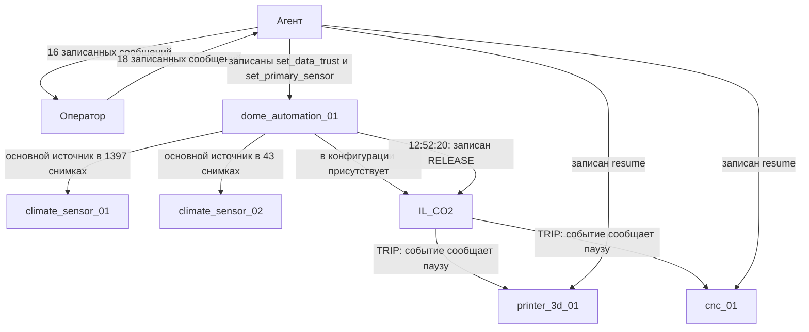
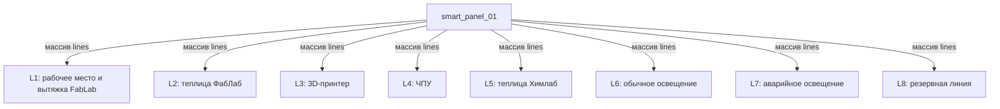

# Граф знаний по локальным журналам 14.10.2026

Источник — только три файла в Logs/2026-10-14. Сервер, ответы чатбота и документация API в этот граф не включались.

Полный граф: 1049 вершин и 1873 направленные связи. Он содержит 36 устройств, наблюдавшиеся поля, типы JSON, линии щита, программные интерлоки, участников и записи событий. Полный машиночитаемый граф находится в Граф_знаний_по_логам.json; для импорта в редакторы графов — Граф_знаний_по_логам.graphml.

Ниже показана часть графа, относящаяся к зафиксированному эпизоду CO₂. Стрелки обозначают сведения из записей, а не независимо проверенную физическую причинность.

Другой непосредственно записанный фрагмент:

Названия линий взяты из их поля name. Они не заменяют проверенную схему электропроводки. В полном графе не добавлялись неподтверждённые связи между насосом, фильтром, баком, охлаждением и конкретными станками.

## Поля и типы

Словарь данных содержит 659 путей полей телеметрии 36 устройств, включая вложенные объекты и элементы массивов; также разобраны 7 видов записей и 18 групп параметров фактически записанных действий.

- JSON-типы: boolean, integer, number, string, array, object, null.
- Объединение типов означает, что в журнале встречались разные типы одного поля.
- У 35 путей полей наблюдался только null: тип ненулевого значения остаётся неизвестным.
- Символ * в пути означает элемент массива, например /lines/*/power_w.
- Числовые min/max — пределы наблюдений за эти сутки, не разрешённый диапазон API.
- Набор строковых значений — только наблюдавшиеся значения, не полный enum.
- Время ts в исходных журналах не содержит часового пояса; он не был придуман при обработке.

В Словарь_данных_по_логам.json у каждого поля есть типы с числом наблюдений, примеры, наличие в снимках, null, числовые экстремумы, длины массивов и ссылка на файл/строку первого наблюдения.

## Что означает связь в полном графе

| Связь | Значение |
|---|---|
| HAS_OBSERVED_FIELD | Поле действительно встречалось в телеметрии узла |
| HAS_OBSERVED_TYPE | У поля действительно встречался такой JSON-тип |
| CONTAINS_LINE | Объект линии находится в массиве щита |
| CONTAINS_INTERLOCK | Интерлок присутствует в конфигурации ПЛК |
| SELECTED_CO2_SOURCE | В конфигурации выбран этот идентификатор источника |
| MARKED_DATA_UNRELIABLE | В конфигурации присутствовала пометка недоверия к параметру |
| REPORTED_HOLD_REASON | Узел сообщил этот код удержания |
| EVENT_REPORTS_PAUSE_OF | Событие автоматики перечисляет этот узел в paused |
| ISSUED_RECORDED_ACTION | В журнале есть соответствующий запрос от участника |
| SENT_RECORDED_MESSAGE / ADDRESSED_TO | Участники и адресат сообщения записаны в метаданных |
| REPORTS_CHANGE_OF | Запись change сообщает изменение поля |

Каждая связь содержит evidence_samples: исходный файл, номер строки и ts; для телеметрии также путь к данным. Тексты сообщений и бортового журнала сохранены как свидетельства авторов, без автоматического превращения их предположений в установленные причины.
