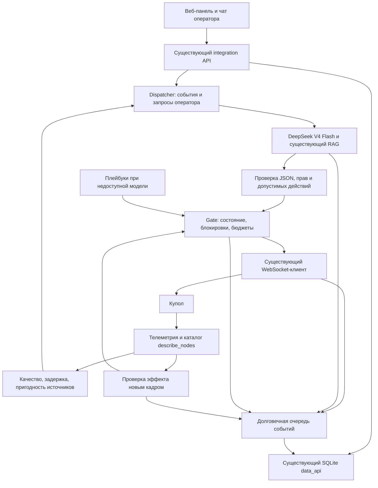

# Актуализация автономного агента Купола

Локальная доработка поверх `agent/llm-layer`, commit **2e0c0350952ea251a98a35c1597433e1acac2f99**.
Ветка: `work/resilience-prompts-20261026`. Интерфейс: `integration/web`, сервер: `integration/server.py`.
Streamlit относится к старому симулятору; новые промпты и управление от него не зависят.
Изменения не отправлялись на GitHub и не включались на физическом Куполе.

## Что использовать

- `../../prompts/system.md.j2` и `user.md.j2` — **реальные подключённые шаблоны**, расширенные под DeepSeek V4 Flash.
- `../../llm_agent/schemas.py` — действительный формат JSON. Сохранён существующий контракт ответа; маршрут указан в `situation`.
- `ИНСТРУКЦИИ_АГЕНТУ.md`, `Плейбуки_агента.json`, `Матрица_инструкций.md` — подробная инженерная политика, 32 правила.
- `РАЗБОР_ДНЯ.md` и `Реестр_эпизодов.json` — разбор 1440 кадров, 8 эпизодов, 6 интервалов деградации.
- `implementation_manifest.json`, `test_results.json`, `replay_result.json` — версия, покрытие и проверяемые ограничения.

32 правила описывают целевую политику. Это не заявление, что реализованы 32 самостоятельных контроллера
или выполнены все 40 требований из приёмочной спецификации. Фактические проверки перечислены отдельно.

## Встраивание в новую архитектуру



Новый LLM-агент, API, БД, веб-панель, RAG и диспетчер не создавались заново. Использованы текущие реализации.
В `integration/runtime.py` дополнительно исправлена идемпотентность обращения оператора: повтор того же
ID и текста не создаёт дубль, а другой текст с тем же ID возвращает конфликт 409, вместо тихой потери новой задачи.
Перед отправкой команды намерение и бюджеты сохраняются. Весь обмен с Куполом, запрос/ответ LLM,
решения, действия и проверки проходят через имеющийся рекордер и конверт `contracts/event.schema.json`.
`event_id` повторной доставки не меняется; `run_id`, `session_id` и исходный тип `request_id` сохраняются.
Неизвестные поля и исходная телеметрия сохраняются независимо от маршрута решения.

## Детерминированные изменения

1. Датчики с задержкой 900/1800 с, OFFLINE/UNKNOWN/DEGRADED и некорректной задержкой не голосуют о текущем состоянии.
   Бюджет задержки 30 с — явная консервативная локальная политика, а не установленная граница физики Купола.
2. NaN, infinity, bool и числовые строки не превращаются в числовые измерения; сырой материал сохраняется.
3. Вложенные индексы/значения вентилятора и замка проверяются по типу и диапазону из API.
4. Нельзя исключить последний пригодный климатический источник или выбрать задержанный основной.
5. Верификация требует нового кадра и продвижения времени целевого узла. Общий зависший источник времени обнаруживается отдельно.
6. План ждёт проверки каждого шага, следующий шаг заново проходит Gate. Отказ, отсутствие эффекта и смена сессии прерывают хвост.
   Ответ оператору по его запросу не исчезает при отказе; сообщение о выполнении откладывается до проверки эффекта.
7. E09 не сбрасывается по погоде/таймеру. В текущем API нет проверяемого допуска по изоляции.
   Возврат IL_OVERCURRENT также запрещён по одному истёкшему таймеру.
8. Автоматическое квитирование IL_SMOKE, отменяющее пожарную реакцию, запрещено без проверяемого допуска текущего события/зоны.
   Действующего контракта такого допуска нет. Физическая проверка и разрешённая процедура остаются за оператором.
9. Сохраняются pending-команды, антидребезг и бюджет resume. Неизвестная доставка после перезапуска сверяется без повторной отправки.
10. Очередь записи получает fsync до фоновой доставки, атомарно заменяется при очистке, восстанавливается после перезапуска
    и повторяет доставку без появления нового события. Повреждённый остаток сохраняется и объявляется ошибкой хранения.

## Принтер и фрезер после кризиса

Наблюдаемая в дневных логах программная остановка — `PAUSED` с `hold_reason`. Когда причина устранена,
интерлок подтверждён как `ARMED`, данные актуальны, задание определено, координаты известны и нет ALARM/lockout,
разрешается ограниченный `resume`. Проверяется **тот же файл, рабочее состояние и увеличение прогресса**.
Принтер и CNC восстанавливаются отдельно. Число попыток переживает перезапуск агента.

`OFF/ABORTED/IDLE` после потери питания не приравниваются к паузе. Слепой `start_job` может начать изготовление
повторно, столкнуть инструмент с деталью или потерять координаты. Продолжение такого задания требует процедуры
восстановления, проверки стола/заготовки и подтверждённого задания; текущий API не гарантирует восстановление с середины.
Хвост многошагового плана после перезапуска процесса не восстанавливается вслепую: сначала reconciliation и новое решение.

## Ручное подтверждение в новой панели

В upstream есть `Cmd.confirmed`: подтверждённая человеком ручная команда обходит часть политик и защит Gate.
Этот существующий режим сохранён. LLM не формирует такой флаг: из `AgentDecision` он не переносится в команды.
Он не является доказательством безопасного состояния и не должен автоматически выставляться промптом/адаптером.
Запись намерения и ограничение роли соединения действуют и для ручного режима. Политика ручного допуска требует
отдельной эксплуатационной оценки; тесты автономного агента не доказывают безопасность произвольной ручной команды.

## Настройка и проверки

Результаты: **197 текущих проверок контура Купола и 83 проверки интеграции прошли**. Ранее выполнен
прогон 763 тестов без медленных симуляций; затронутые модули после последних правок проверены повторно.
Полный исходный набор: **773 passed**, включая 52 медленных теста. Эти 52 теста повторно не запускались:
код старого симулятора и его входы проверены как неизменённые. Подробное сопоставление и XML — в
`test_results.json` и `reports/`. Это не новый единый полный прогон всех 828 тестов агента после правок.

Модель по умолчанию — `deepseek-v4-flash`. Действующие переменные окружения имеют приоритет;
`LLM_MODEL` и `DEEPSEEK_MODEL` нужно согласовать при подключении. Реальный endpoint и доступ к модели
проверяются отдельно: оплачиваемых запросов в этой работе не было.

`DATA_API_URL` должен быть настроен на имеющийся сервис. Пустой URL выключает запись обмена в БД в существующей архитектуре;
такой запуск не соответствует профилю «всё в БД». При недоступной БД запись остаётся в durable outbox,
а недоступная обязательная серверная проверка отклоняет новые предложения модели.
Ошибка локального сохранения блокирует новые команды; аппаратные защиты от модели не зависят.

В веб-архитектуре состояние изолировано по `run_id`. Для восстановления **той же физической смены**
между перезапусками сервера задайте стабильный `DATA_API_RUN_ID`; без него Hub создаёт новый случайный ID,
и прежняя очередь/бюджеты автоматически не подхватываются. Для нового опыта, эмулятора и другой установки
используйте разные ID. Это существующий способ согласования жизненного цикла, без изменения интерфейса.

Из корня репозитория:

```powershell
./research/resilience-2026-10-26/verify.ps1 -Python /absolute/path/to/python.exe
# -Quick явно исключает 52 медленные проверки старого симулятора.
```

Тесты используют локальный эмулятор, заглушку LLM и HTTP в памяти. Исторический прогон — только чистая диагностика,
без будущих свидетельств и без имитации новых управляющих эффектов. Реальная пожарная ситуация, характеристики оборудования,
полная модель общих причин отказов, долговременное переполнение диска и качество ответов настоящей DeepSeek требуют
дополнительных испытаний. Результаты локальных тестов не являются гарантией безопасности физической установки.

В историческом прогоне CO2 и влажность имеют `unknown` на 1440 кадрах из-за отсутствия двух пригодных
текущих источников по принятой политике. Это **не 1440 аварий**: качество доказательств и маршрут реакции
разделены. Штатные события сохраняются без управляющего действия; предупреждение требуется при тревожном
значении/интерлоке. Достижимость автоматического восстановления с реальным набором задержек требует отдельной
проверки и согласованного режима работы при деградации измерений.
